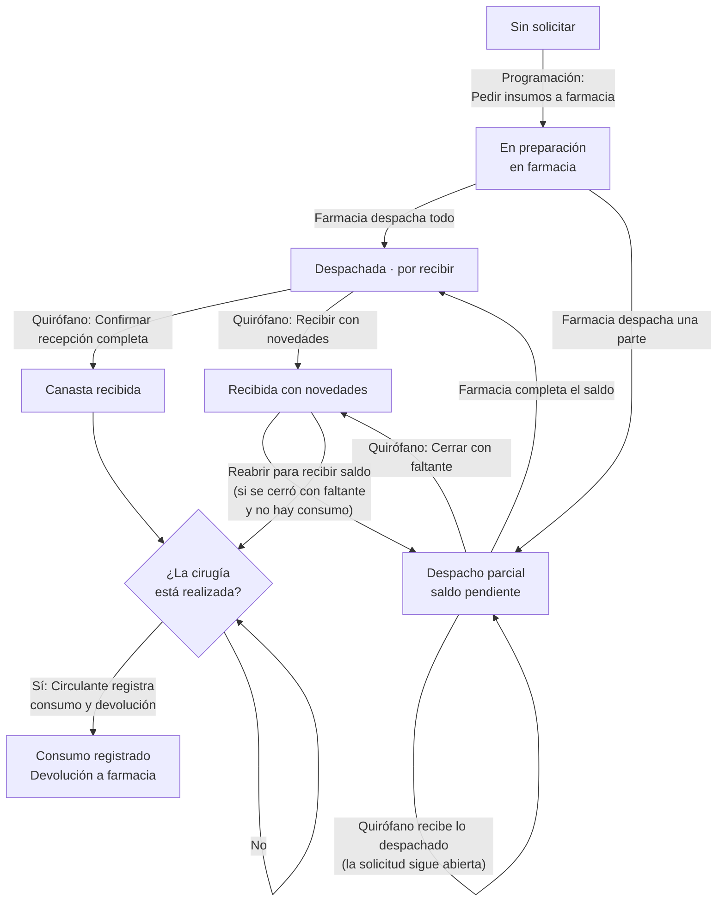
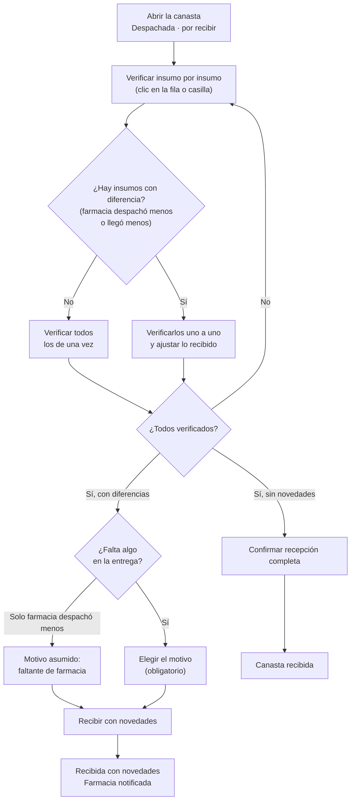

# Documentación funcional — Clintos

## Canastas de cirugía

**Propósito:** seguir las canastas de insumos de las cirugías del día desde que farmacia las prepara hasta que el quirófano las recibe, registra lo que realmente usó y devuelve a farmacia lo que sobró. Existe para el personal de quirófano que recibe los insumos y los legaliza: **enfermería quirúrgica** (recepción) y **circulante** (consumo y devolución). La canasta se pide a farmacia desde Programación sala de cirugías; aquí solo se recibe, se cierra y se devuelve.

**Rutas:** `/cirugia/canastas` (menú Cirugía → Canastas de cirugía) y `/cirugia/canastas/historial` (historial de solicitudes, se abre con el botón de reloj del encabezado). La pantalla principal tiene dos vistas: **Tabla** (por defecto) y **Detalle** (`?vista=detalle`). Se puede llegar con `?sala=…&fecha=…&cirugia=…` (así llega "Ver en Canastas" de Programación) y abre ese día con esa cirugía seleccionada.

**Roles** (confirmados por grupo de acciones; hoy el sistema no aplica permisos por rol: la sesión es un usuario de ejemplo, "Administrador", y todo queda a nombre de "Camilo Grondona"):

| Grupo de acciones | Rol |
|---|---|
| Recibir la canasta, recibir con novedades, recibir un despacho parcial, cerrar con faltante y reabrir una solicitud | Enfermería quirúrgica |
| Registrar el consumo real y la devolución a farmacia | Circulante |
| Ver el historial de canastas | Circulante |
| Pedir los insumos a farmacia, vincular la canasta | Programación de cirugía (desde su propia pantalla; ver Programación sala de cirugías) |

**Por confirmar:** el acceso de solo consulta a las vistas Tabla y Detalle, a los indicadores y al historial para los demás roles (coordinación de quirófano, farmacia, programación). Se asume que quien actúa puede ver, pero no se definió por rol.

**Estados de una canasta** (no se guardan: se calculan a partir de lo que cada insumo lleva de su camino por farmacia y quirófano):

| Estado | Cuándo aplica |
|---|---|
| Sin solicitar | Ningún insumo se ha pedido a farmacia. |
| En preparación en farmacia | Se pidió y farmacia aún no despacha nada. |
| Despachada · por recibir | Farmacia despachó **todo** lo solicitado y falta recibirlo. |
| Despacho parcial · saldo pendiente | Farmacia despachó solo una parte; la solicitud sigue abierta. |
| Canasta recibida | Se recibió completa y sin diferencias. |
| Recibida con novedades | Se recibió con faltantes, daños u otra diferencia, o se cerró con faltante. |
| Consumo registrado | Ya se registró lo usado y se generó la devolución. |

---

### Ciclo de una canasta

Quién actúa en cada paso y qué estado deja. Lo que está a cargo de farmacia solo se simula en el prototipo.



### Flujo de la recepción en quirófano



### Ver las solicitudes del día en tabla

- **Qué hace:** lista las canastas de todas las cirugías de un día (de todas las salas, o de una), ordenadas por hora, con hora, sala, alerta de tiempo, paciente, procedimiento, estado de la canasta, cuántos insumos van recibidos y un botón para ver el detalle. Clic o Enter en una fila abre el detalle de la canasta en un modal.
- **Roles con acceso:** Enfermería quirúrgica y Circulante (consulta; ver "Por confirmar" arriba).
- **Reglas de negocio:**
  - Se muestran las cirugías del día de la Sede Norte, incluidas las realizadas (su canasta sigue abierta para consumo y devolución) y excluidas las canceladas y las incumplidas (ya no tienen canasta que gestionar).
  - **Recibidos:** insumos de la canasta que ya pasaron a "entregado" sobre el total, o "—" si la canasta no tiene insumos.
  - Una cirugía de urgencia lleva la etiqueta "Urgencia" junto al procedimiento.
  - Sin resultados se avisa "Ninguna solicitud coincide con los filtros."; mientras carga, "Cargando canastas…".
  - Al abrir una solicitud, el modal "Canasta de la cirugía" muestra su detalle; queda abierto tras confirmar una acción, para ver el resultado, y lo cierra el usuario. El **consumo y la devolución no se registran en ese modal**: se hacen desde la hoja de gasto de la cirugía o desde la vista Detalle.

### Ver la alerta de tiempo de una canasta

- **Qué hace:** en la tabla, una etiqueta avisa cuando una canasta aún no recibida se acerca a la hora de su cirugía.
- **Roles con acceso:** Enfermería quirúrgica y Circulante (consulta).
- **Reglas de negocio:**
  - Solo aplica a cirugías abiertas (programadas o de urgencia), sin iniciar, **del día de hoy**, cuya canasta todavía no se recibió.
  - Pasada la hora de inicio: "Atrasada" con el tiempo transcurrido, en rojo, hasta que se reciba la canasta o se cierre la cirugía.
  - Antes de la hora: "Faltan N · <punto en que va la canasta>" (sin solicitar, en preparación, saldo pendiente o por recibir). Ámbar si faltan menos de 3 horas; rojo si falta menos de 1 hora.
  - Si la canasta ya fue despachada y solo falta recibirla, avisa (ámbar) únicamente cuando falta menos de 1 hora.

### Navegar por fecha

- **Qué hace:** cambia el día que se muestra con las flechas (día anterior y siguiente) o abriendo un calendario para saltar a una fecha puntual.
- **Roles con acceso:** Enfermería quirúrgica y Circulante (consulta).
- **Reglas de negocio:**
  - Arranca en hoy; la etiqueta dice "Hoy · …" cuando corresponde.
  - Cambiar de día vuelve a cargar las canastas.
  - Si se llega con `?fecha=` válido (formato AAAA-MM-DD) abre ese día; un valor inválido se ignora.

### Buscar y filtrar las canastas

- **Qué hace:** acota lo que se ve por texto, sala y estado de la canasta.
- **Roles con acceso:** Enfermería quirúrgica y Circulante (consulta).
- **Reglas de negocio:**
  - **Búsqueda:** por paciente, documento, procedimiento o número de solicitud; ignora mayúsculas.
  - **Sala:** Todas las salas (por defecto) o una de las de la Sede Norte.
  - **Estado:** Todos los estados, Despachadas por recibir, Con saldo pendiente, En preparación, Recibidas (incluye con novedades y con consumo registrado) o Consumo pendiente (cirugía realizada con canasta recibida y consumo sin registrar).
  - Los indicadores y el filtro de estado se combinan.
  - En la vista Tabla la barra es de una sola fila (fecha, buscador, y a la derecha sala y estado); en la vista Detalle, el buscador y los filtros se abren desde dos íconos del panel izquierdo (lupa y ajustes) y "Limpiar estado" quita el filtro de estado.

### Ver los indicadores de canastas

- **Qué hace:** cuatro indicadores del día, en el orden de la tarea: Despachadas por recibir, Consumo pendiente, En preparación y Canastas recibidas.
- **Roles con acceso:** Enfermería quirúrgica y Circulante (consulta).
- **Reglas de negocio:**
  - Los conteos son sobre todas las cirugías de la sala elegida (no sobre lo que dejan pasar el buscador ni el filtro de estado).
  - Cada indicador es también un filtro de estado, tipo interruptor: al pulsarlo se filtra la lista y al pulsarlo de nuevo se quita.
  - **Canastas recibidas** cuenta las recibidas, las recibidas con novedades y las de consumo registrado.

### Usar la vista Detalle (maestro-detalle de una sala)

- **Qué hace:** a la izquierda, las cirugías del día agrupadas por lo que requieren; a la derecha, la canasta de la cirugía seleccionada con sus pestañas de recepción y de consumo.
- **Roles con acceso:** Enfermería quirúrgica y Circulante.
- **Reglas de negocio:**
  - Se elige con el selector "Tabla | Detalle" del encabezado; la elección vive en la dirección (`?vista=detalle`).
  - La lista agrupa en: **Requiere acción** (hay algo por recibir o consumo pendiente), **Pendientes de farmacia** (sin solicitar, en preparación o con saldo pendiente) y **Completadas**; dentro de cada grupo, por hora. Los grupos vacíos no aparecen y cada título muestra su conteo.
  - Cada tarjeta muestra la hora y cuánto falta ("Inicia en 45 min", "Hora de inicio superada"), el paciente (con etiqueta "Urgencia" si aplica), el procedimiento (dos líneas), el estado de la canasta y el número de solicitud.
  - Sin selección explícita, se abre la primera canasta despachada por recibir (lo accionable) o, si no hay, la primera de la lista. La selección se calcula sobre la lista completa del día, no sobre la filtrada, para que un filtro no deje el detalle en blanco.
  - Un día sin cirugías en la sala muestra "No hay cirugías programadas en esta sala para esta fecha." y deja a la vista la fecha y la sala para poder cambiarlas.
  - Los borradores (lo verificado, lo ajustado, lo usado, la pestaña abierta) se conservan por cirugía al cambiar de selección.

### Ver el detalle de una canasta

- **Qué hace:** muestra la solicitud (número y estado de la canasta), con un bloque plegable de paciente, procedimiento y horario, un aviso según el estado y las pestañas **Recepción** y **Consumo y devolución**.
- **Roles con acceso:** Enfermería quirúrgica y Circulante.
- **Reglas de negocio:**
  - El bloque de paciente, procedimiento y horario arranca plegado para dejarle alto a la tabla.
  - **Avisos** (solo cuando el estado no lo dice por sí solo): en preparación; despacho parcial (con las unidades de saldo y qué hacer); recibida con novedades (según el origen: farmacia o entrega); para una cirugía realizada, el siguiente paso (registrar consumo y devolución, o recibir lo despachado y cerrar con faltante, o que no hay consumo que registrar si la canasta no se recibió).
  - La pestaña "Consumo y devolución" está bloqueada (con candado y explicación) hasta que la cirugía esté realizada; cuando lo está, abre por defecto en ella.
  - Los errores de una acción aparecen en el detalle, en rojo, y dejan todo como estaba.
  - Cada solicitud muestra el número de pedido a farmacia; sin él ("—") la canasta aún no se solicitó.

### Recibir la canasta completa

- **Qué hace:** cuando farmacia despachó todo lo solicitado, el quirófano verifica insumo por insumo lo que llegó y confirma la recepción.
- **Roles con acceso:** Enfermería quirúrgica.
- **Reglas de negocio:**
  - Cada insumo se verifica con clic en su fila o en su casilla. "Verificar todos" solo marca los insumos **sin diferencia**; los que traen diferencia se revisan uno a uno, a propósito.
  - Una diferencia puede venir de farmacia (despachó menos de lo solicitado) o de la entrega (llegó menos de lo despachado). Los insumos que farmacia despachó cortos aparecen primero, resaltados.
  - Cada fila muestra lo despachado y lo recibido. Lo recibido se puede **ajustar** con − y + entre 0 y lo despachado; no puede superarlo.
  - El pie muestra "N de M insumos verificados", cuántos con diferencia faltan por verificar y una barra de avance. "Confirmar recepción" se habilita solo con todos verificados.
  - Todo verificado y sin novedades: "Confirmar recepción completa" → canasta **recibida**.
  - Todo verificado y con diferencias: "Recibir con novedades" (ver siguiente funcionalidad).
  - Una canasta con 8 o más insumos tiene buscador en las vistas de lectura; al confirmar la recepción se verifican todos los insumos, sin filtrar.
  - Queda registrado quién la recibió y cuándo (formato `29.SEP.2026 - 08:10`).

### Recibir con novedades

- **Qué hace:** registra una recepción con diferencias y avisa a farmacia.
- **Roles con acceso:** Enfermería quirúrgica.
- **Reglas de negocio:**
  - El panel "Novedad de la recepción" aparece cuando hay diferencia y todo está verificado, o apenas hay un faltante en la entrega (que exige motivo).
  - **Motivo:** Faltante de farmacia, Faltante en la entrega, Insumo dañado, Insumo vencido o por vencer, Lote distinto al solicitado u Otro. Si la diferencia es solo de farmacia, el motivo ya viene asumido como "Faltante de farmacia". **Si hay faltante en la entrega (o de ambos orígenes), el motivo es obligatorio** y el botón se deshabilita sin él.
  - **Nota:** opcional, hasta 240 caracteres, "detalle para farmacia".
  - La canasta queda "Recibida con novedades" y farmacia queda notificada. En cada insumo queda escrito qué faltó ("Farmacia despachó 3 de 5 · Faltan 1 en la entrega").
  - El servicio revalida todo antes de guardar: las cantidades enteras entre 0 y lo pendiente, el motivo exigido y que el motivo exista en el catálogo; si algo falla, no se guarda nada.

### Recibir un despacho parcial y cerrar con faltante

- **Qué hace:** cuando farmacia despacha solo una parte, el quirófano recibe lo que llegó y la solicitud sigue abierta hasta que farmacia complete el saldo o se acepte el faltante.
- **Roles con acceso:** Enfermería quirúrgica.
- **Reglas de negocio:**
  - La tabla muestra por insumo lo Solicitado, Despachado, Recibido y "Recibir ahora" (editable entre 0 y lo despachado pendiente de recibir); lo que falta por despachar se marca en ámbar ("Faltan 2 por despachar").
  - "Recibir lo despachado (N u.)" suma lo recibido sin cerrar la solicitud; se deshabilita si no hay nada por recibir. Se avisa "Recepción parcial registrada: la solicitud … sigue abierta".
  - Un listado de movimientos muestra cada despacho de farmacia y cada recepción de quirófano, del más viejo al más nuevo.
  - **Cerrar con faltante:** solo se habilita cuando ya se recibió todo lo despachado (si no, el aviso dice "Recibe primero lo que farmacia ya despachó") y con un motivo. La canasta queda "Recibida con novedades", con origen farmacia, y desde ese momento se puede registrar el consumo.
  - **Reabrir para recibir saldo:** una solicitud cerrada con faltante se puede reabrir si farmacia despacha el saldo después, mientras no se haya registrado el consumo (con consumo, las cantidades usadas y devueltas quedarían inválidas). Conserva lo despachado y lo recibido y deja constancia de la reapertura.

### Registrar el consumo y la devolución

- **Qué hace:** tras la cirugía, registra cuánto de lo recibido se usó realmente y genera la devolución a farmacia de lo que sobró, en una sola acción.
- **Roles con acceso:** Circulante.
- **Reglas de negocio:**
  - Solo con la cirugía **realizada** y la canasta **recibida** (recibida, con novedades o con consumo ya registrado); si no, la pestaña dice "La canasta no fue recibida, no hay consumo que registrar."
  - Cada insumo muestra lo Recibido, lo Usado (editable entre 0 y lo recibido; por defecto se asume que se usó todo) y lo que se debe Devolver (recibido menos usado, en verde si es cero).
  - Si la hoja de gasto de la cirugía ya está registrada, lo usado se **precarga** por nombre de insumo para confirmarlo o corregirlo (lo que se edite a mano manda); si la hoja usa otro listado, se avisa y se revisa a mano. Sin hoja registrada se recuerda que lo habitual es registrar el consumo desde la hoja de gasto, que hace ambas cosas en un paso.
  - El pie anticipa "Devolución a farmacia: N unidades en M insumos".
  - Al registrar se crea la devolución con su número consecutivo y los datos de código y lote de cada insumo; esa devolución también se ve en "Devoluciones en Cirugías" de Programación. Queda escrito quién registró y cuándo ("Consumo registrado por … · N unidades enviadas a devolución"), y la canasta pasa a "Consumo registrado".
  - Cada cantidad usada debe ser un entero entre 0 y lo recibido; si no, no se registra.
  - Una vez registrado, la cantidad usada ya no se edita.

### Deshacer la última acción

- **Qué hace:** después de recibir, cerrar con faltante, reabrir, registrar el consumo o simular un despacho, el aviso inferior ofrece "Deshacer" para volver la canasta a como estaba.
- **Roles con acceso:** Enfermería quirúrgica y Circulante.
- **Reglas de negocio:**
  - El aviso con "Deshacer" dura 5 segundos; sin esa opción, 2,6 segundos.
  - Deshacer restablece la cirugía tal como estaba antes de la acción.
  - Tras una acción, la canasta queda seleccionada para ver su resultado y se descartan los borradores de esa cirugía.

### Simular el despacho de farmacia (solo demo)

- **Qué hace:** como no hay integración con farmacia, el prototipo ofrece atajos para simular que farmacia despachó: "Simular despacho completo (demo)", "Simular despacho parcial (demo)" (la canasta en preparación) y "Simular saldo de farmacia (demo)" (el despacho parcial).
- **Roles con acceso:** no corresponde a ningún rol: es una ayuda del prototipo que desaparecerá con la integración real.
- **Reglas de negocio:**
  - El despacho parcial deja el último insumo con una unidad de menos; el saldo completa lo que falta.
  - Los avisos indican "(simulado)".

### Ir al Panel general y al historial

- **Qué hace:** el encabezado ofrece un botón de reloj ("Historial de canastas") y "Panel general".
- **Roles con acceso:** Enfermería quirúrgica y Circulante.
- **Reglas de negocio:** ambos solo navegan; el historial se describe a continuación.

---

## Historial de canastas

**Propósito:** consultar las solicitudes de canastas a farmacia y su estado, como registro de lo pedido y recibido.

**Ruta:** `/cirugia/canastas/historial` (botón de reloj en Canastas de cirugía; "Volver a canastas" regresa).

**Roles:** Circulante (confirmado para consulta). Es de solo lectura.

### Ver y filtrar el historial

- **Qué hace:** tabla con el número de solicitud, la fecha de solicitud (formato `30.SEP.2026 - 08:10`), el paciente, el procedimiento, la sala, el estado de la canasta, quién la solicitó y quién la recibió ("—" si aún no se recibió).
- **Roles con acceso:** Circulante.
- **Reglas de negocio:**
  - **Búsqueda:** por número de solicitud, paciente o procedimiento.
  - **Estado:** Todos los estados o cualquiera de los siete estados de una canasta.
  - Sin resultados: "Ninguna solicitud coincide con los filtros."
  - Los datos son de ejemplo y no están conectados a las canastas reales de la pantalla principal.

### Ver el detalle de una solicitud del historial

- **Qué hace:** el ícono de ojo de cada fila abre el modal "Solicitud N", con el estado de la canasta en el encabezado, los datos de la solicitud (paciente, procedimiento, sala, fecha, quién solicitó y quién recibió) y la lista de insumos con su cantidad.
- **Roles con acceso:** Circulante.
- **Reglas de negocio:**
  - Es solo lectura; Escape cierra el modal.
  - La lista de insumos del historial es de ejemplo.

---

## Notas generales y límites conocidos

- **Prototipo con datos en memoria:** las canastas, las recepciones, los consumos y las devoluciones viven en el navegador y se pierden al recargar la página. Los catálogos y el historial son datos de ejemplo.
- **Sin integración con farmacia:** el despacho se simula; no hay un servidor que avise cuando farmacia prepara o despacha. Hoy la pantalla tampoco se actualiza sola: refleja solo lo que se hace en ella.
- **Permisos:** no existe control de acceso por rol; los roles documentados son los definidos para el producto, no uno que el sistema verifique hoy. Todo queda registrado a nombre del usuario de ejemplo.
- **Hora del sistema en la demo:** el "ahora" de la pantalla (alertas de tiempo, "Inicia en N min") usa una hora fija de demostración (08:45 del día actual), no el reloj real.
- **Sede única:** opera siempre sobre la Sede Norte.
- **Historial desconectado:** el historial es una lista fija de ejemplo; las solicitudes que se crean o se reciben en la pantalla principal no aparecen en él.
- **Esta pantalla no decide el inicio de la cirugía:** solo describe el estado de la canasta. La regla "la canasta debe estar recibida para iniciar" vive en el Panel general.
- **Consumo desde el modal de la tabla:** el modal de la vista Tabla no ofrece el consumo y la devolución; se registran desde la hoja de gasto de la cirugía o desde la vista Detalle.

---

## Prompt para crear el front de esta pantalla

Brief para un diseñador o desarrollador que deba construir (o reconstruir) las pantallas desde cero. Es autocontenido: no depende del código existente.

```text
Necesito diseñar y construir la pantalla "Canastas de cirugía" de un sistema clínico hospitalario (producto Clintos), con su pantalla hermana "Historial de canastas". La usa el personal de quirófano para recibir los insumos que despacha farmacia para cada cirugía del día, registrar lo que realmente se usó y devolver lo que sobró. Todo el texto de la interfaz va en español.

OBJETIVO
Que el personal de quirófano sepa de un vistazo qué canastas están por llegar, cuáles ya llegaron y cuáles deben legalizarse después de la cirugía, y que pueda recibir cada canasta con precisión (insumo por insumo), con trazabilidad de quién hizo qué y cuándo, y con posibilidad de deshacer.

USUARIOS Y PERMISOS
- Enfermería quirúrgica: recibe las canastas (completas, con novedades o parciales), cierra con faltante y reabre.
- Circulante: registra el consumo real y la devolución a farmacia; consulta el historial.
- Programación de cirugía pide los insumos desde otra pantalla; aquí no se piden.
Lo que un rol no puede hacer debe verse deshabilitado, con el motivo en un aviso al pasar el cursor.

CONCEPTO CENTRAL: ESTADO DE LA CANASTA (7 estados, siempre con ícono/texto y color)
1. Sin solicitar (gris). 2. En preparación en farmacia (gris). 3. Despachada · por recibir (azul). 4. Despacho parcial · saldo pendiente (ámbar). 5. Canasta recibida (verde). 6. Recibida con novedades (ámbar). 7. Consumo registrado (violeta).
Cada estado se muestra con una etiqueta (badge) redondeada de 11 px en seminegrita; nunca solo con color.

ESTRUCTURA GENERAL (escritorio, 1025 px o más)
Dentro del marco de la aplicación (barra lateral azul y barra superior con migas "Cirugía > Canastas de cirugía"):

1) Encabezado de página
- Título "Canastas de cirugía" y debajo "Verifica, recibe y legaliza los insumos de las cirugías del día."
- A la derecha: selector segmentado "Tabla | Detalle" (Tabla por defecto), un botón cuadrado de solo ícono (reloj) "Historial de canastas" y un botón secundario con ícono "Panel general".

2) Fila de 4 indicadores compactos (una sola línea cada uno: ícono, etiqueta, valor), que funcionan como filtros tipo interruptor (activo = resaltado)
- "Despachadas por recibir" (azul), "Consumo pendiente" (ámbar), "En preparación" (gris), "Canastas recibidas" (verde).

3) Contenido: según la vista.

VISTA TABLA (por defecto)
- Tarjeta blanca con borde fino y esquinas de 12 px. Barra de herramientas en una sola fila: navegador de fecha a la izquierda (flecha "día anterior", una etiqueta clicable "Hoy · 29 sep" que abre un calendario flotante, flecha "día siguiente"); buscador con lupa y placeholder "Buscar paciente, procedimiento o solicitud..."; espacio flexible; selector de sala ("Todas las salas", Quirófano #1, #2, #3, Gastroenterología, Hemodinamia, Proc. Menores) y selector de estado ("Todos los estados", "Despachadas por recibir", "Con saldo pendiente", "En preparación", "Recibidas", "Consumo pendiente").
- Tabla: Hora · Sala · Alerta de tiempo · Paciente · Procedimiento · Estado de la canasta · Recibidos (n/m, alineado a la derecha, "—" si no hay insumos) · Acciones (botón de ojo "Ver detalle").
  - Encabezado fijo, 12 px en seminegrita, sin mayúsculas. Fila clicable y enfocable (Enter abre el detalle). Sin mostrar el documento del paciente.
  - Procedimiento: si es de urgencia, etiqueta ámbar "Urgencia" a su lado.
  - Alerta de tiempo: etiqueta con ícono. Rojo con triángulo: "Atrasada 1 h 15 min" o "Faltan 40 min · por recibir". Ámbar con reloj: "Faltan 2 h · en preparación". Vacío si no hay nada que avisar.
- Vacío: ícono de paquete y "Ninguna solicitud coincide con los filtros."; cargando: "Cargando canastas…".
- Clic en una fila abre el MODAL "Canasta de la cirugía" (ver abajo).

VISTA DETALLE (maestro-detalle)
- Dos paneles lado a lado con 16 px de separación. Izquierda (460 px de ancho fijo, 410 px en tablet; tarjeta): navegador de fecha, fila de dos botones de ícono (lupa que despliega un buscador "Paciente o solicitud"; ajustes que abre un panel flotante con "Quirófano", "Estado de la canasta" y un botón "Limpiar estado" cuando hay filtro) y la lista de cirugías agrupadas con títulos y conteo: "Requiere acción", "Pendientes de farmacia", "Completadas". Cada tarjeta de cirugía: a la izquierda la hora grande y debajo cuánto falta ("Inicia en 45 min", "Hora de inicio superada"); a la derecha el paciente (con "Urgencia" si aplica), el procedimiento (máximo 2 líneas, nombre completo en tooltip), la etiqueta de estado y el número de solicitud. La tarjeta seleccionada se resalta (borde y fondo azul claro). Sin resultados: "Ninguna cirugía coincide con los filtros." / "Sin cirugías en esta sala."
- Derecha (el resto del ancho, tarjeta): el detalle de la canasta de la cirugía seleccionada (ver "Detalle de la canasta"). Sin cirugías ese día: icono de paquete y "No hay cirugías programadas en esta sala para esta fecha." (los controles de fecha y sala siguen visibles).

DETALLE DE LA CANASTA (panel derecho y cuerpo del modal)
- Cabecera: "Solicitud 4596" con la etiqueta de estado y, si aplica, "Urgencia"; botón de chevron que pliega o despliega una cuadrícula con Paciente, Procedimiento y Horario (formato "21.AGO.2026 - 07:00 – 09:00"). Arranca plegada.
- Aviso (banner de una línea con ícono de información; tonos neutro, ámbar o azul) cuando el estado necesita explicación: "Farmacia está preparando la canasta…", "Farmacia despachó menos de lo solicitado (saldo: 3 u.)…", "Canasta recibida con novedades: farmacia fue notificada", "Cirugía realizada. Registra el consumo real y la devolución…".
- Mensaje de error en rojo (role="alert") si una acción falla.
- Pestañas "Recepción" y "Consumo y devolución" (esta última con candado y deshabilitada, con explicación "se habilita al marcar la cirugía como realizada", hasta que la cirugía esté realizada; cuando lo está abre por defecto ahí). En el modal de la vista Tabla no hay pestaña de consumo.
- Dentro de la pestaña, cuerpo con tabla que scrollea y pie fijo con mensaje y acciones.

PESTAÑA RECEPCIÓN — 6 MODOS SEGÚN EL ESTADO
A) Despachada · por recibir (editable): tabla con columna de casilla (con casilla maestra "Verificar todos los insumos sin diferencias", tri-estado), Insumo, Despachado, Recibido. Clic en la fila marca la casilla. Las filas con diferencia con farmacia (despachado < solicitado) van primero, con fondo ámbar tenue, número en ámbar y texto "de 5", y debajo del nombre un aviso "Farmacia despachó 3 de 5". En "Recibido" se ve el valor y un enlace "Ajustar" que lo convierte en un control −/+ (entre 0 y lo despachado). Si lo recibido es menor que lo despachado, la fila muestra "Faltan N en la entrega".
   Pie: "N de M insumos verificados" con barra de progreso y, si hay filas con diferencia sin verificar, "2 con diferencia: verifícalos uno a uno". Botón primario "Confirmar recepción (n/m)" deshabilitado hasta verificar todo; con todo verificado y sin novedades pasa a "Confirmar recepción completa"; con diferencias pasa a "Recibir con novedades" (contorno ámbar con triángulo), deshabilitado si falta el motivo obligatorio.
   Panel "Novedad de la recepción" (caja ámbar con ícono de alerta) que aparece cuando hay diferencia y todo está verificado, o cuando hay faltante en la entrega: texto explicativo, selector "Motivo" (Faltante de farmacia, Faltante en la entrega, Insumo dañado, Insumo vencido o por vencer, Lote distinto al solicitado, Otro; con asterisco si es obligatorio) y "Nota (opcional)" de 2 líneas con máximo 240 caracteres. Si la diferencia es solo de farmacia, el motivo viene preseleccionado.
B) Despacho parcial: tabla Insumo, Solicitado, Despachado, Recibido, "Recibir ahora" (control −/+). Filas con saldo en ámbar con "Faltan 2 por despachar". Lista de movimientos debajo ("29.SEP.2026 - 08:10 · Farmacia despachó: 2 Gasas, 1 Sutura" / "Recibido por Camilo Grondona: …"). Cuando ya se recibió todo lo despachado aparece el panel de novedad. Pie: mensaje ("Hay 5 u. despachadas por recibir. Farmacia aún debe despachar 3 u.: la solicitud sigue abierta."), botón secundario "Simular saldo de farmacia (demo)", botón de contorno ámbar "Cerrar con faltante" (deshabilitado hasta recibir todo lo despachado y elegir motivo; con tooltip "Recibe primero lo que farmacia ya despachó") y botón primario "Recibir lo despachado (N u.)".
C) En preparación: tabla de solo lectura Insumo (con "Preparados 3 de 8" en el encabezado), Solicitado y Estado (etiqueta verde "Preparado" o gris "Pendiente"). Pie: "Podrás verificar la canasta cuando farmacia la despache." y los botones demo "Simular despacho parcial" y "Simular despacho completo".
D) Sin solicitar: mensaje centrado "Esta canasta todavía no fue solicitada a farmacia." y en el pie "Los insumos se solicitan desde Programación…". Si la cirugía no tiene insumos: "Esta cirugía no tiene insumos en su canasta."
E) Recibida / con novedades / con consumo (lectura): resumen con ícono ("8 de 8 insumos recibidos sin novedades" en verde, o "2 de 8 insumos con novedad" en ámbar) y una línea de trazabilidad ("Recibida con novedades por Camilo Grondona · 29.SEP.2026 - 08:10 · Motivo: Insumo dañado · Farmacia notificada"); tabla Insumo, Despachado, Recibido (con ícono ámbar o verde por fila cuando hay novedades); buscador si hay más de 8 insumos y novedades; nota de la recepción si existe. Si se cerró con faltante y no hay consumo: pie con "Si farmacia despacha el saldo, reabre la solicitud para recibirlo." y botón secundario "Reabrir para recibir saldo".

PESTAÑA CONSUMO Y DEVOLUCIÓN
- Si la canasta no fue recibida: "La canasta no fue recibida, no hay consumo que registrar."
- Si no hay consumo registrado: aviso informativo (según haya o no hoja de gasto registrada y coincidencias: "Lo usado se precargó desde la hoja de consumo (6 de 8 insumos). Confírmalo o corrígelo.") y tabla Insumo, Recibido, Usado (control −/+ entre 0 y lo recibido; por defecto igual a lo recibido) y Devolver (recibido − usado; verde si es 0, resaltado si es mayor). Buscador si hay más de 8 insumos. Pie: "Devolución a farmacia: 5 unidades en 2 insumos" y botón primario "Registrar consumo y devolución" (ícono de paquete con check).
- Con consumo registrado: lo usado queda fijo y el pie dice "Consumo registrado por Camilo Grondona · 29.SEP.2026 - 10:20 · 5 unidades enviadas a devolución".

MODAL "CANASTA DE LA CIRUGÍA" (vista Tabla)
Ancho amplio, encabezado con ícono de paquete en círculo azul, título "Canasta de la cirugía" y subtítulo "Paciente · 21.AGO.2026 - 07:00 – 09:00"; el cuerpo es el detalle de la canasta (sin pestaña de consumo); pie con botón "Cerrar". Queda abierto después de confirmar una acción. Escape cierra.

AVISO INFERIOR (toast) Y DESHACER
Barra flotante inferior con punto de color y mensaje ("Canasta de Laura G. recibida", "Recepción parcial registrada: la solicitud … sigue abierta", "Solicitud de … cerrada con faltante", "Solicitud … reabierta", "Consumo de … registrado"). Tras una acción incluye un botón de texto "Deshacer" y dura 5 s; sin él, 2,6 s. role="status".

PANTALLA HERMANA: HISTORIAL DE CANASTAS
- Encabezado "Historial de canastas" y "Consulta las solicitudes de canastas a farmacia y su estado."; botón secundario "Volver a canastas" (flecha izquierda).
- Tarjeta con barra de una fila: buscador "Paciente o solicitud", espacio flexible y selector de estado ("Todos los estados" y los siete estados).
- Tabla: Solicitud · Fecha de solicitud ("30.SEP.2026 - 08:10") · Paciente · Procedimiento · Sala · Estado (etiqueta) · Solicitó · Recibió ("—" si no aplica) · Acciones (ojo "Ver detalle"). Vacío: "Ninguna solicitud coincide con los filtros."
- Modal "Solicitud 4596" de solo lectura: estado como etiqueta junto al título, cuadrícula de datos (Paciente y Procedimiento a doble ancho; Sala, Fecha de solicitud, Solicitó, Recibió) y tabla de insumos (Insumo, Cantidad). Botón "Cerrar".

SISTEMA VISUAL
- Tipografía: la del sistema (system-ui, Segoe UI, Helvetica, Arial). Escala fija: 11, 12, 14 (base), 16, 18, 20, 24 y 28 px. Pesos: 400 cuerpo, 500 énfasis, 600 todos los títulos y etiquetas, 700 solo cifras de indicadores. Los títulos nunca van en 700.
- Color: primario azul #0065CD (oscuro #004E9E, fondo claro #EEF4FF, selección #DBE8FE); tinta #101827 / #374151 / #6B7280; borde #E5E8EF; superficie #FFFFFF; fondo de página #F4F6FB. Éxito #12A150 sobre #E6F8EE (texto #0D7A3D); peligro #C02B2B sobre #FDECEB; ámbar #E08A00 sobre #FFF4E0 (texto #A45A05); violeta #6D3FD6 sobre #F1ECFF; informativo azul sobre #EEF4FF. El rojo se reserva para error o peligro. Nunca texto negro ni blanco puro.
- Forma: radios de 8 px en controles y botones, 12 px en tarjetas, 20 px en etiquetas. Una sola sombra para menús y paneles flotantes (0 8px 24px con 16 % de opacidad); se prefiere borde fino sobre sombra en tarjetas.
- Botones: primario (azul sólido), secundario (blanco con borde), contorno, contorno ámbar, peligro y variante pequeña (32 px); controles de 36 px de alto. Ícono a la izquierda (18 px; 15 px en pequeño). Deshabilitado al 45 %. Foco visible con contorno de 2 px azul separado 2 px.
- Controles −/+ (stepper): botones de 28 px con ícono, valor centrado en el medio, deshabilitados en los límites.
- Casillas personalizadas (verificar) de 20 px con check; estado intermedio con raya.
- Íconos: set Lucide, siempre con texto cuando comunican estado.
- Fechas con hora: formato "21.AGO.2026 - 07:00".
- Espaciado en múltiplos de 4 px.

RESPONSIVE
- Escritorio (1025 px o más): como se describió.
- Tablet (768 a 1024 px): el contenido hace scroll de página; los 4 indicadores siguen en 4 columnas; en la vista Detalle, la lista y el detalle siguen lado a lado con un alto mínimo de 640 px; los objetivos táctiles (botones, filas, casillas, −/+) miden al menos 44 px.
- Por debajo de 768 px no está en alcance.

ACCESIBILIDAD
- Todo se opera con teclado: filas y tarjetas con Enter o Espacio, pestañas con flechas, menús y paneles con Escape para cerrar y devolver el foco al botón que los abrió.
- Cada casilla, botón −/+ y enlace "Ajustar" lleva nombre accesible con el insumo ("Verificar Gasas estériles", "Disminuir recibido de Gasas estériles").
- El estado se comunica con texto e ícono, no solo con color. Barras de progreso con role="progressbar". Los avisos usan role="status" y los errores role="alert".
- Los modales atrapan el foco, tienen nombre accesible y se cierran con Escape.

DATOS DE EJEMPLO PARA MAQUETAR
Cirugías del día en varias salas (Quirófano #1, #2, #3 en mantenimiento, Gastroenterología, Hemodinamia, Proc. Menores), con paciente, procedimiento, horario, número de solicitud, insumos con cantidad solicitada, despachada, recibida y usada, y motivos de novedad. Incluye casos límite: una canasta con 30 insumos, nombres largos, cirugía de urgencia, cirugía atrasada con la canasta sin recibir, despacho parcial con tres movimientos, canasta cerrada con faltante (reabrible), canasta sin insumos, día sin cirugías y lista vacía por filtros.

ENTREGABLES
Maqueta navegable de escritorio y tablet con la vista Tabla y la vista Detalle, los seis modos de la pestaña Recepción, la pestaña Consumo y devolución, el modal de la tabla, el aviso con "Deshacer" y la pantalla de Historial con su modal, con los estados vacío, cargando, deshabilitado, foco y error de cada control.
```
