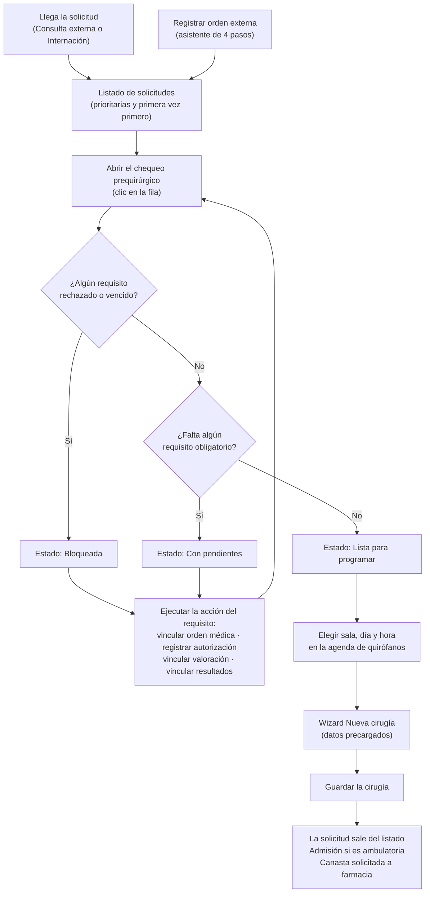
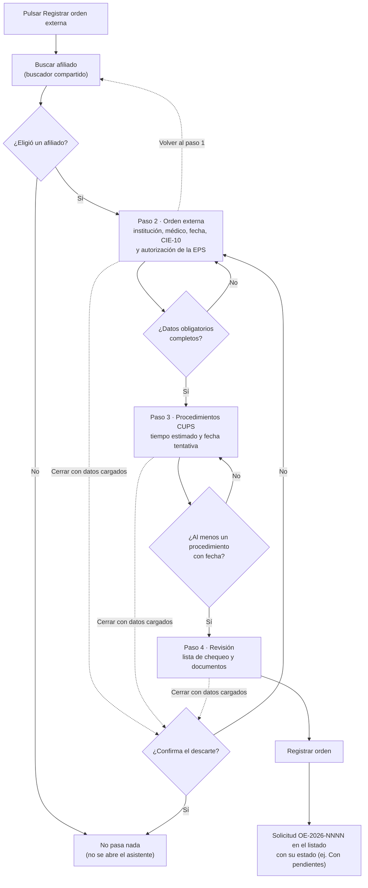
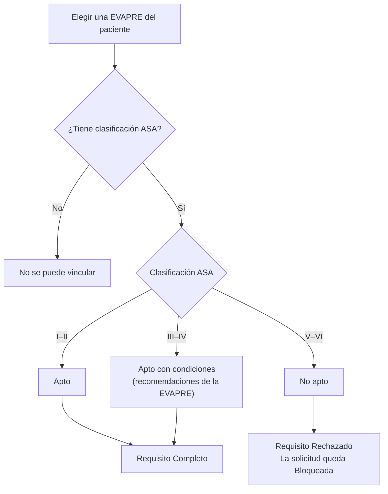

# Documentación funcional — Clintos

## Gestión de cirugías

**Propósito:** concentrar las solicitudes de cirugía que llegan al hospital (desde Consulta externa, Internación u Orden externa) y verificar, antes de programarlas, que cada una tenga completa su lista de chequeo prequirúrgico (orden médica, autorización de la EPS, valoración preanestésica y estudios). Existe para el equipo de **Programación de cirugía**, que decide cuáles solicitudes ya se pueden pasar a la agenda de salas.

**Ruta:** `/cirugia/gestion` (menú Cirugía → Gestión de cirugías).

**Roles:** todas las funcionalidades de este submódulo las ejecuta el rol **Programación de cirugía** (confirmado). Hoy el sistema no aplica permisos por rol: la sesión es un usuario de ejemplo ("Administrador") y todo lo que registra queda a su nombre.

**Estados de una solicitud** (se calculan solos a partir del chequeo; no se editan a mano):

| Estado | Cuándo aplica |
|---|---|
| Lista para programar | Todos los requisitos **obligatorios** están completos. |
| Con pendientes | Falta al menos un requisito obligatorio. |
| Bloqueada | Algún requisito está **rechazado** o **vencido**. Prima sobre los demás estados. |

**Requisitos del chequeo:** Orden médica · Autorización de la EPS · Valoración preanestésica · Estudios requeridos (Laboratorios + Estudios de imágenes). Cada requisito puede estar *Completo*, *Pendiente*, *Rechazada*, *Vencida* o *No requerido*. Un requisito *No requerido* o marcado opcional nunca bloquea ni cuenta como faltante.

---

### Flujo general de una solicitud

Recorrido completo de una solicitud, desde que llega hasta que se programa. Los estados se recalculan solos después de cada acción sobre un requisito.

### Ver el listado de solicitudes

- **Qué hace:** muestra una tabla con las solicitudes pendientes de programar: paciente (solo el nombre), procedimiento, aseguradora, prioridad, diagnóstico (primera vez / recurrente), origen y estado del chequeo con su avance (ej. 4/5). Arriba, cuatro indicadores con el conteo: Todas las solicitudes, Listas para programar, Con pendientes y Bloqueadas. Los indicadores se muestran en una línea (vista compacta, por defecto) o en tarjeta completa (vista expandida); ver "Configurar la vista".
- **Roles con acceso:** Programación de cirugía.
- **Reglas de negocio:**
  - Orden fijo: primero las **prioritarias**; dentro de cada grupo, las de diagnóstico de **primera vez** primero.
  - El **documento y la edad del paciente no se muestran** en la tabla, en el modal de chequeo ni en la franja del paciente al elegir el hueco de agenda. La búsqueda sí sigue aceptando el número de documento. Los modales de vincular orden, resultados, valoración y autorización todavía muestran el documento enmascarado (últimos 4 dígitos) junto al nombre.
  - Las solicitudes de Consulta externa e Internación llegan automáticamente; las de Orden externa las crea esta pantalla (ver más abajo).
  - Una solicitud ya programada sale de la lista.
  - El pie de la tabla indica cuántas solicitudes se ven del total.

### Buscar y filtrar solicitudes

- **Qué hace:** acota el listado por texto, origen, diagnóstico y estado del chequeo.
- **Roles con acceso:** Programación de cirugía.
- **Reglas de negocio:**
  - **Búsqueda:** por nombre del paciente, número de documento o procedimiento; ignora tildes y mayúsculas.
  - **Origen:** Consulta externa, Internación u Orden externa.
  - **Diagnóstico:** Primera vez o Recurrente.
  - **Estado:** al pulsar un indicador (Listas, Con pendientes, Bloqueadas) se filtra por ese estado; pulsarlo de nuevo lo quita.
  - Los números de los indicadores se calculan sobre lo que dejan pasar los demás filtros, para que coincidan con las filas que aparecen al pulsarlos.
  - "Limpiar filtros" solo aparece cuando hay algún filtro activo.

### Configurar la vista

- **Qué hace:** el botón "Configuración de vista" (ícono de ajustes, al final de la barra de filtros; el mismo menú del Panel general de cirugía) controla cómo se ve la pantalla: el **tipo de vista** de los indicadores y las columnas de validaciones de la tabla.
- **Roles con acceso:** Programación de cirugía.
- **Reglas de negocio:**
  - **Tipo de vista:** *Compacto* (por defecto) muestra cada indicador en una línea; *Expandido* los muestra como tarjeta completa. Cambiarlo no cierra el menú, así se ve el efecto al instante. No hay vista de tablero en esta pantalla.
  - **Mostrar validaciones:** muestra u oculta en bloque las columnas del chequeo (Orden, Estudios, Valoración y Autorización) en la tabla. Por defecto están ocultas.
  - "Estado del chequeo" siempre queda visible como resumen, aunque las columnas estén ocultas.
  - Las preferencias valen solo mientras la pantalla está abierta; al recargar vuelven a los valores por defecto.

### Revisar el chequeo prequirúrgico de una solicitud

- **Qué hace:** al hacer clic (o Enter/Espacio) en una fila se abre el modal "Chequeo prequirúrgico" con los datos de la solicitud (paciente, orden, CUPS y procedimientos, prioridad, diagnóstico, aseguradora, régimen y contrato) y la lista de chequeo con el estado y el detalle de cada requisito. Desde ahí se ejecutan las acciones de cada requisito (secciones siguientes).
- **Roles con acceso:** Programación de cirugía.
- **Reglas de negocio:**
  - Cada requisito ofrece una acción según su estado: *Vincular orden médica*, *Registrar autorización* (o *Registrar renovación* si está rechazada/vencida), *Vincular valoración*, *Vincular resultados*; si ya está completo, la acción pasa a ser de consulta (*Ver orden*, *Ver autorización*, *Ver valoración*, *Ver resultados*).
  - Si la solicitud no está lista, el panel explica por qué ("Para programar falta: …"). Si faltan todos los obligatorios y todos están pendientes, lo resume en una línea.
  - Un requisito opcional pendiente se avisa como informativo y **no bloquea** la programación.
  - "Siguiente solicitud" pasa a la siguiente fila del listado (con el orden y filtros actuales) sin cerrar el modal y muestra la posición (ej. 2 de 10).
  - Escape cierra el modal.

### Registrar orden externa

- **Qué hace:** abre un asistente de 4 pasos en modal para registrar una solicitud de un paciente que llega con una orden emitida por **otra institución**. Al terminar, la orden entra al listado con su lista de chequeo ya armada.
- **Roles con acceso:** Programación de cirugía.
- **Reglas de negocio:**
  - **Paso 1 · Paciente:** se elige en el buscador de afiliados compartido ("Buscar afiliado", el mismo de Programar cita). El asistente solo se abre cuando se elige un afiliado; si se cierra el buscador sin elegir, no pasa nada. El asistente arranca en el paso 2 y el paso 1 queda para revisar o cambiar el paciente. Se precarga la entidad pagadora (EPS, régimen, contrato) y se avisa cuántas órdenes activas tiene el paciente.
  - **Paso 2 · Orden externa:** son obligatorios la institución que remite (catálogo), el médico que ordena, la fecha de la orden (no puede ser futura), el diagnóstico CIE-10 (catálogo de diagnósticos) y la **autorización de la EPS**. El documento de la orden es **opcional**; si no se adjunta, el requisito "Orden médica" queda pendiente en el chequeo.
  - **Autorización de la EPS (paso 2):** se registra con el mismo modal de "Registrar autorización" (ver más abajo): N° obligatorio, documento de soporte opcional. Deja el requisito "Autorización" como completo.
  - **Paso 3 · Procedimientos CUPS:** se eligen del catálogo CUPS en una ventana (selección múltiple; los ya agregados salen deshabilitados). Por procedimiento: tiempo estimado (de 30 min a 4 h, precargado desde el catálogo) y **fecha tentativa obligatoria** (no anterior a hoy). La fecha elegida se copia a los procedimientos que aún no tienen una. Se muestra la cobertura del contrato (Cubierto, Requiere autorización, No cubierto). Se necesita al menos un procedimiento.
  - **Paso 4 · Revisión:** muestra la lista de chequeo tal como quedará, con el estado general y los documentos adjuntos (orden y autorización) con acceso para verlos. "Registrar orden" crea la solicitud, la agrega al listado y avisa con su estado (ej. "Orden registrada para … · Con pendientes").
  - El asistente no deja avanzar si falta algo del paso actual (el aviso azul del fondo lista qué falta) y los pasos siguientes están bloqueados hasta completar los anteriores; siempre se puede volver a un paso ya visitado.
  - Cerrar con datos de la orden ya cargados pide confirmar el descarte.
  - La solicitud queda con origen "Orden externa" y número `OE-2026-NNNN`. Las solicitudes de este origen se consideran ambulatorias.
  - Los datos de régimen, contrato e historia clínica del paciente salen de un directorio de ejemplo cuando el documento coincide; si no, quedan por defecto (Contributivo, sin estudios en la historia), por lo que los estudios aparecerán pendientes.

### Vincular orden médica

- **Qué hace:** completa el requisito "Orden médica" tomando una orden que el paciente ya tiene en el submódulo Órdenes médicas de Historia clínica (no se escribe a mano).
- **Roles con acceso:** Programación de cirugía.
- **Reglas de negocio:**
  - Se listan las órdenes de Historia clínica del paciente; al elegir una fila se previsualizan sus servicios (cirugía, medicamento, consulta, laboratorio).
  - Elegir = clic en la fila; doble clic o Enter sobre la ya elegida la vincula.
  - Al vincular, el requisito pasa a Completo y su detalle registra el N° de orden, la fecha y quién la emitió.

### Registrar autorización de la EPS

- **Qué hace:** completa el requisito "Autorización de la EPS" registrando el N° que emitió la aseguradora y, opcionalmente, su documento de soporte. También se usa para **renovar** una autorización rechazada o vencida.
- **Roles con acceso:** Programación de cirugía.
- **Reglas de negocio:**
  - El **N° de autorización es obligatorio**; el documento (PDF o imagen) es opcional.
  - Queda registrado el usuario que la registró y la fecha con hora (formato `13.OCT.2026 - 14:05`).
  - Solo si el soporte es un PDF queda disponible "Ver autorización"; con una imagen se guarda el nombre pero no se puede abrir en el visor.
  - Si un procedimiento no está cubierto por el contrato, el requisito aparece pendiente indicando que requiere autorización especial de la EPS.
  - El N° y quién autoriza se precargan después en el paso 1 del wizard "Nueva cirugía".

### Vincular valoración preanestésica (EVAPRE)

- **Qué hace:** completa el requisito "Valoración preanestésica" vinculando una evaluación preanestésica (EVAPRE) ya registrada en Historia clínica.
- **Roles con acceso:** Programación de cirugía (la EVAPRE la genera previamente Anestesiología en Historia clínica).
- **Reglas de negocio:**
  - Se elige una EVAPRE del paciente; no se diligencia un formulario. Solo se pueden vincular las que tienen clasificación ASA.
  - El concepto se **deriva del ASA**: I–II → Apto; III–IV → Apto con condiciones (las recomendaciones de la EVAPRE son las condiciones); V–VI → **No apto**.
  - Apto o apto con condiciones: el requisito queda Completo. **No apto: el requisito queda Rechazado y la solicitud se bloquea.**
  - Se precargan Asa y tipo de anestesia en el wizard "Nueva cirugía".

### Vincular resultados de laboratorios y estudios de imágenes

- **Qué hace:** completa el requisito "Estudios requeridos" vinculando los resultados registrados en la sección de Laboratorios de una EVAPRE del paciente (no se cargan a mano).
- **Roles con acceso:** Programación de cirugía.
- **Reglas de negocio:**
  - **Laboratorios** se piden siempre; **Estudios de imágenes** solo si algún procedimiento de la solicitud lo requiere (si no, quedan "No requerido").
  - Al elegir una EVAPRE se previsualizan sus resultados; solo se puede elegir una que tenga al menos un resultado.
  - El estado del requisito "Estudios requeridos" resume sus dos partes: un rechazo o vencimiento prima, luego pendiente, luego completo.

### Ver documentos del chequeo

- **Qué hace:** abre en un visor (sin salir de la pantalla) los documentos de soporte: la orden médica y la autorización de la EPS.
- **Roles con acceso:** Programación de cirugía.
- **Reglas de negocio:**
  - Solo disponible cuando el requisito está completo y tiene un archivo cargado (PDF).
  - Escape cierra únicamente el visor, no el modal de debajo.

### Programar cirugía desde una solicitud

- **Qué hace:** desde una solicitud lista, elegir sala, día y hora en la agenda semanal de quirófanos y continuar al wizard "Nueva cirugía", que se abre con paciente, procedimientos, aseguradora, diagnóstico, autorización y duración precargados.
- **Roles con acceso:** Programación de cirugía.
- **Reglas de negocio:**
  - **Solo se puede programar una solicitud en estado "Lista para programar"** (todos los obligatorios completos).
  - La agenda muestra las cirugías ya programadas de la sala; una franja solo está libre si la sala (y el cirujano, si hay filtro por cirujano) lo están. Se puede ver jornada operativa (07:00–19:00) o 24 horas, y semana hábil, completa o 3 días.
  - La duración estimada sale de la suma de los tiempos de los procedimientos, ajustada a la menor duración del catálogo que la cubre (120 min por defecto si un procedimiento no trae tiempo).
  - Personal y equipos se eligen después, en el wizard.
  - Al guardar la cirugía, la solicitud sale del listado; si es ambulatoria (cualquier origen distinto de Internación) se crea la admisión, y se solicita la canasta a farmacia.
  - **Nota de estado actual:** el botón "Programar cirugía" del pie del chequeo está **oculto** por una bandera (`MOSTRAR_PROGRAMAR = false` en `SolicitudPanel.jsx`); el flujo está construido pero hoy se llega a él desde Programación de cirugía, no desde este modal.

---

## Notas generales y límites conocidos

- **Prototipo con datos en memoria:** las solicitudes, órdenes registradas y documentos adjuntos viven en el navegador y se pierden al recargar la página. Los catálogos (instituciones, diagnósticos, CUPS, pacientes) son datos de ejemplo.
- **Permisos:** no existe control de acceso por rol; el rol documentado (Programación de cirugía) es el definido para el producto, no uno que el sistema verifique hoy.
- **Documentos adjuntos:** solo los PDF se pueden abrir en el visor; con imágenes se guarda el nombre pero no el enlace.
- **Pendiente de definir:** si "Orden médica" debe seguir siendo obligatoria en el chequeo cuando la orden externa se registra sin documento (hoy lo es: la solicitud queda con pendientes hasta vincularla).
