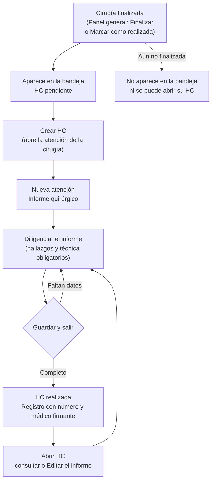

# Documentación funcional — Clintos

## Historia clínica de Cirugía

**Propósito:** llevar la historia clínica de las cirugías ya realizadas. Una bandeja reúne las cirugías finalizadas y dice cuáles todavía no tienen su **informe quirúrgico** (nota operatoria); desde ella se abre la atención de cada cirugía, donde el cirujano diligencia el informe, lo consulta o lo edita, y consulta o inicia órdenes médicas del paciente. Existe para los **cirujanos** (que firman el informe) y para la **coordinación de quirófano** (que da seguimiento a las historias pendientes).

**Rutas:**
- `/cirugia/historia-clinica` (menú Cirugía → Historia clínica): bandeja de cirugías finalizadas.
- `/cirugia/historia-clinica/[id]` (con `?tab=<pestaña>` para abrir directo en una pestaña): atención de una cirugía. Es la misma pantalla de atención de Consulta externa y de Hospitalización, con su propia variante de Cirugía.
- Fuera de alcance de este documento: el **Historial quirúrgico** de un paciente (`/cirugia/historial-quirurgico/[id]`), que es otra pantalla y se abre desde Programación sala de cirugías.

**Roles** (confirmados; hoy el sistema no aplica permisos por rol: la sesión es un usuario de ejemplo, "Administrador", y el informe se firma con el médico de ejemplo de la sesión):

| Grupo de acciones | Rol |
|---|---|
| Diligenciar y editar el informe quirúrgico; iniciar órdenes médicas | Cirujano (médico que operó) y Cirujano ayudante |
| Ver la bandeja de cirugías finalizadas y abrir la historia clínica de una cirugía (consulta) | Cirujanos y médicos tratantes, y Coordinación de quirófano |

**Estados de la historia clínica de una cirugía:**

| Estado | Cuándo aplica |
|---|---|
| HC pendiente | La cirugía está finalizada (estado "realizada") y todavía no tiene informe quirúrgico. |
| HC realizada | La cirugía ya tiene su informe quirúrgico guardado. |

---

### Ciclo de la historia clínica de una cirugía

Una cirugía entra a la bandeja al finalizarse (desde el Panel general) y sale de "pendiente" cuando se guarda su informe.



### Ver la bandeja de cirugías finalizadas

- **Qué hace:** lista las cirugías finalizadas de los últimos 31 días, la más reciente primero, con fecha y hora, paciente, procedimiento, sala, cirujano, estado de la historia clínica y un botón de acción por fila. Arriba, tres indicadores: Cirugías finalizadas, HC pendientes y HC realizadas.
- **Roles con acceso:** Cirujanos y médicos tratantes, y Coordinación de quirófano.
- **Reglas de negocio:**
  - Solo entran las cirugías en estado "realizada" de la Sede Norte (no hay selector de sede). Las programadas, canceladas e incumplidas no aparecen.
  - **Indicadores:** "Cirugías finalizadas" (con el periodo elegido, "este mes"), "HC pendientes" ("Sin informe quirúrgico") y "HC realizadas" ("Con informe quirúrgico"). Se calculan sobre el rango de fechas elegido, antes del filtro de estado y del buscador. Son solo informativos: no filtran al pulsarlos.
  - **Acción por fila:** "Crear HC" (botón primario) si la cirugía está pendiente; "Abrir HC" (botón de contorno) si ya tiene informe. Clic o Enter en cualquier parte de la fila hace lo mismo: abre la atención de esa cirugía.
  - La tabla no muestra el documento del paciente.
  - Estados vacíos: "Cargando cirugías…", "Todavía no hay cirugías finalizadas." (el rango no tiene ninguna) y "Ninguna cirugía coincide con los filtros.".
  - No hay paginación: se listan todas las cirugías del rango.

### Buscar y filtrar la bandeja

- **Qué hace:** acota las cirugías por texto, rango de fechas y estado de la historia clínica.
- **Roles con acceso:** Cirujanos y médicos tratantes, y Coordinación de quirófano.
- **Reglas de negocio:**
  - **Búsqueda:** por nombre del paciente, documento, procedimiento o cirujano; ignora mayúsculas.
  - **Rango de fechas:** Hoy, Semana (lunes a domingo) o Mes en curso. **Arranca en "Mes"**, porque una historia pendiente puede ser de días atrás y con "Hoy" quedaría fuera de la vista.
  - **Estado:** Todos los estados, HC pendiente o HC realizada.
  - Los indicadores cuentan sobre el rango elegido; el estado y el buscador solo recortan la tabla.
  - **Expandir tabla:** un botón de ícono al final de la barra compacta los indicadores a una línea para darle ese alto a la tabla; vuelve a expandirlos al pulsarlo otra vez. No se recuerda al recargar.

### Abrir la atención de una cirugía

- **Qué hace:** muestra la atención de la cirugía: el banner del paciente y de la cirugía, y las pestañas de la historia. Se llega desde la bandeja, desde "Ir a HC" del Panel general (que hoy lleva a la bandeja, no a una cirugía puntual) o por dirección directa.
- **Roles con acceso:** Cirujanos y médicos tratantes, y Coordinación de quirófano.
- **Reglas de negocio:**
  - **Banner:** muestra el nombre, el documento (con la opción de ocultarlo), el sexo, la edad y el diagnóstico; "Ver más" y el chevron lo expanden con la fecha y hora de la cirugía, la sala, el procedimiento, el cirujano y el diagnóstico. Arranca contraído.
  - **No encontrada:** si la cirugía no existe o todavía no está finalizada, se muestra "No encontramos esta cirugía — Puede que el enlace esté vencido o la cirugía todavía no esté finalizada." con el botón "Volver a cirugías finalizadas". Mientras carga se ve "Cargando atención…".
  - Las migas de pan son Cirugía › Historia clínica › Atención del paciente.
  - **Pestañas:** "Historia clínica" y "Órdenes médicas" están activas; Incapacidades, Consentimiento informado, Resultados, Alergias, Alertas y Archivos están deshabilitadas con el aviso "Próximamente". Con `?tab=` se abre directo en una pestaña activa; cualquier otro valor se ignora. Las flechas, Inicio y Fin recorren las pestañas activas.

### Consultar los registros de la historia clínica

- **Qué hace:** en la pestaña "Historia clínica", un panel izquierdo lista los registros de la cirugía y el área derecha muestra el registro elegido.
- **Roles con acceso:** Cirujanos y médicos tratantes, y Coordinación de quirófano.
- **Reglas de negocio:**
  - Hoy el único tipo de registro de esta variante es el **INFOQX** (informe quirúrgico). Hay como máximo uno por cirugía.
  - **Panel de registros:** vista agrupada por tipo (por defecto; el grupo INFOQX muestra su contador y se despliega) o lista plana, que alterna con el chevron del encabezado. Cada registro muestra fecha y hora, número, título, autor y "especialidad - plantilla" con el ámbito (QX).
  - **Filtro:** "Todas las historias clínicas" (por defecto) o "Hechas por mí" (solo los del usuario en sesión; oculta los grupos que quedan vacíos).
  - **Área derecha:** título, fecha, hora y autor del registro, con las acciones **Resumen**, **Imprimir**, **Editar** y **Ver detalle**. Sin registros se muestra "Aún no hay historia clínica registrada".
  - Seleccionar un registro muestra además iconos de imprimir y editar sobre su tarjeta.
  - **Ver detalle:** simula una carga de 1,2 segundos y despliega el detalle debajo; "Ocultar detalle" lo pliega.
  - **Hoy Resumen e Imprimir no hacen nada con el informe quirúrgico:** "Resumen" solo funciona en registros con resumen guardado y "Imprimir" en los que traen un documento original.

### Crear el informe quirúrgico (Nueva atención)

- **Qué hace:** abre el catálogo de plantillas y, al elegir "Informe quirúrgico", un formulario para redactar la nota operatoria de la cirugía.
- **Roles con acceso:** Cirujano y Cirujano ayudante.
- **Reglas de negocio:**
  - **Nueva atención** (botón del panel izquierdo, o la tecla `+` sola, cuando no hay un campo de texto con el foco) abre el catálogo con buscador por código o descripción. El catálogo de Cirugía tiene una sola plantilla: **INFOQX · Informe quirúrgico**. El botón "+" del grupo INFOQX abre el formulario directamente, sin pasar por el catálogo.
  - Elegir la plantilla muestra un aviso de carga de 1,2 segundos antes de abrir el formulario.
  - El informe solo existe dentro de una cirugía: no se puede crear desde otras variantes.
  - **Datos que parte precargados:** el procedimiento realizado (el de la cirugía), los diagnósticos preoperatorio y posoperatorio (el diagnóstico de ingreso), "Ninguna" en complicaciones, conteo de gasas e instrumental "Sí" y muestras a patología "No".
  - **Campos:** procedimiento realizado, diagnóstico preoperatorio, diagnóstico posoperatorio, **hallazgos (obligatorio)**, **descripción de la técnica (obligatoria)**, complicaciones, sangrado estimado (mL), conteo de gasas e instrumental completo (Sí/No), muestras a patología (Sí/No) y plan posoperatorio.
  - **Guardar y salir:** si falta alguno de los dos obligatorios, se marcan en rojo con "Describe los hallazgos operatorios." o "Describe la técnica quirúrgica." y no se guarda. Con todo completo, se guarda y se vuelve a la lista de registros con el aviso "Informe quirúrgico guardado."
  - "Cancelar" y la flecha de la barra de título salen del formulario **sin pedir confirmación**, perdiendo lo digitado.
  - El formulario se puede expandir a pantalla completa (se compacta el banner) y organizar en dos columnas o en una (menú de ajustes de la barra de título).
  - La barra de título indica si es un "Nuevo registro" o el "Registro N° …".

### Guardar y editar el informe

- **Qué hace:** guarda el informe en la historia de la cirugía y permite corregirlo después con "Editar".
- **Roles con acceso:** Cirujano y Cirujano ayudante.
- **Reglas de negocio:**
  - Al guardar, la cirugía pasa a **HC realizada** en la bandeja.
  - **Firma:** el informe queda a nombre del médico de la sesión, en mayúsculas, con rol "Médico" y especialidad igual al servicio de la cirugía. No se valida que ese médico sea el cirujano de la cirugía.
  - **Número de registro:** se asigna al guardar por primera vez (código `0201` más seis dígitos derivados de la cirugía).
  - **Editar** (botón del área derecha) reabre el formulario con lo guardado. Guardar de nuevo **reemplaza** el informe: no se conservan versiones. Se conservan el número, la fecha y la hora del primer guardado; solo cambia el contenido y el autor.
  - Hay un solo informe por cirugía.
  - El icono de lápiz sobre la tarjeta del registro hoy no hace nada; la acción que funciona es el botón "Editar" del área derecha.

### Consultar y crear órdenes médicas

- **Qué hace:** la pestaña "Órdenes médicas" lista las órdenes del paciente, previsualiza la elegida y permite iniciar una nueva orden. Es el mismo componente de las demás historias clínicas.
- **Roles con acceso:** Cirujano y Cirujano ayudante.
- **Reglas de negocio:**
  - **Lista:** "Todas las órdenes" o "Mis órdenes", más recientes primero; al elegir una se previsualiza por secciones. Sin selección se invita a "Selecciona una orden médica".
  - Un paciente sin órdenes propias en los datos de ejemplo ve el mismo conjunto de ejemplo.
  - **Iniciar nueva orden:** reemplaza la lista por una pantalla con un riel de categorías (órdenes generales, medicamentos, laboratorios, procedimientos de quimioterapia, imagenologías, cirugías, consultas, radioterapia y braquiterapia, entre otras), un formulario para agregar ítems (los medicamentos piden dosis, unidad, presentación, vía, frecuencia y duración; el resto, cantidad, prioritario, única dosis y observaciones) y la tabla de la orden en construcción. Hay un recetario por voz para dictar medicamentos.
  - "Guardar" agrega la orden al inicio de la lista, con el siguiente número, la fecha y hora actuales y el médico en sesión, y la deja seleccionada; "Cancelar" vuelve a la lista.
  - **Límite:** las órdenes nuevas viven solo en esa pestaña; si se sale de la atención se pierden.

---

## Notas generales y límites conocidos

- **Prototipo con datos en memoria:** los informes quirúrgicos y las órdenes nuevas viven en el navegador y se pierden al recargar la página. Las cirugías finalizadas salen de los datos de ejemplo de Programación (una de ellas ya trae informe, para mostrar ambos estados).
- **Permisos:** no existe control de acceso por rol; los roles documentados son los definidos para el producto, no uno que el sistema verifique hoy. El médico firmante es siempre el de la sesión de ejemplo.
- **"Ver detalle" del informe quirúrgico no muestra el informe:** la vista de lectura se diseñó para el ingreso de hospitalización; con un informe quirúrgico muestra las secciones de esa plantilla (Signos vitales, Alergias "No registradas", Información general, Antecedentes, Examen físico y Plan de tratamiento) vacías, y no los campos del informe. Está pendiente una vista de lectura propia del informe quirúrgico.
- **Resumen e Imprimir:** no tienen efecto con el informe quirúrgico (no hay resumen ni documento original).
- **Un informe por cirugía, sin historial de versiones:** editar reemplaza el contenido y no queda constancia de lo anterior.
- **Sin confirmación al salir con datos:** salir del formulario del informe no pide confirmación.
- **"Ir a HC" del Panel general es genérico:** lleva a la bandeja, no a la historia de la cirugía de esa fila.
- **Una sola plantilla:** el catálogo de la HC de Cirugía solo ofrece el informe quirúrgico; la evaluación preanestésica (EVAPRE) vive en otro flujo y se vincula desde Gestión de cirugías.
- **Pestañas pendientes:** Incapacidades, Consentimiento informado, Resultados, Alergias, Alertas y Archivos aparecen deshabilitadas ("Próximamente").
- **Sede única:** la bandeja opera siempre sobre la Sede Norte.

---

## Prompt para crear el front de esta pantalla

Brief para un diseñador o desarrollador que deba construir (o reconstruir) las pantallas desde cero. Es autocontenido: no depende del código existente.

```text
Necesito diseñar y construir la "Historia clínica de Cirugía" de un sistema clínico hospitalario (producto Clintos). Son dos pantallas: (1) una bandeja con las cirugías ya finalizadas y el estado de su historia clínica, y (2) la pantalla de atención de una cirugía, donde el cirujano diligencia su informe quirúrgico. Todo el texto de la interfaz va en español.

OBJETIVO
Que el cirujano y la coordinación de quirófano vean de un vistazo qué cirugías finalizadas siguen sin informe quirúrgico, y que el cirujano pueda redactarlo, consultarlo y corregirlo sin perder el contexto del paciente y de la cirugía.

USUARIOS Y PERMISOS
- Cirujano y cirujano ayudante: crean y editan el informe quirúrgico; inician órdenes médicas.
- Cirujanos, médicos tratantes y coordinación de quirófano: consultan la bandeja y las historias.
Los controles que un rol no puede usar deben verse deshabilitados con el motivo en un aviso al pasar el cursor.

ESTADOS (siempre con texto, nunca solo color)
- "HC pendiente": etiqueta ámbar. Cirugía finalizada sin informe quirúrgico.
- "HC realizada": etiqueta verde. Cirugía con informe quirúrgico guardado.

PANTALLA 1 — BANDEJA "Historia clínica - Cirugía" (escritorio, 1025 px o más)
Dentro del marco de la aplicación (barra lateral azul y barra superior con migas "Cirugía > Historia clínica"):
1) Encabezado: título "Historia clínica - Cirugía" y debajo "Cirugías finalizadas pendientes de su informe quirúrgico." Sin botones de acción.
2) Fila de 3 indicadores (tarjetas con ícono, etiqueta, valor y descripción), solo informativos: "Cirugías finalizadas" (neutro, descripción = el periodo: "este mes"), "HC pendientes" (ámbar, "Sin informe quirúrgico"), "HC realizadas" (verde, "Con informe quirúrgico"). Dos densidades: expandida (tarjeta con descripción) y compacta (una sola línea: ícono y etiqueta a la izquierda, valor a la derecha).
3) Tarjeta principal blanca (borde fino, esquinas de 12 px) que ocupa el alto restante y scrollea por dentro:
   a) Barra de herramientas en UNA sola fila, de izquierda a derecha: buscador con lupa y placeholder "Buscar paciente, procedimiento..." (botón para limpiar); espacio flexible; selector segmentado "Hoy | Semana | Mes" (Mes activo por defecto); selector desplegable "Todos los estados" (HC pendiente, HC realizada); botón cuadrado de solo ícono "Expandir tabla / Contraer tabla" (flechas hacia afuera / hacia adentro; con estado pulsado) que compacta los indicadores. Todos los controles miden 36 px de alto.
   b) Tabla: Fecha y hora ("26.OCT.2026 - 07:00") · Paciente (nombre en seminegrita) · Procedimiento (mayúsculas) · Sala · Cirujano (mayúsculas) · Estado de la HC (etiqueta) · Acciones. Más reciente primero. Encabezado fijo al hacer scroll, texto de 12 px en seminegrita, sin mayúsculas, fondo gris muy claro. Fila clicable y enfocable (Enter abre la atención). No mostrar el documento del paciente. Sin paginación.
   c) Acciones por fila: botón pequeño primario "Crear HC" (ícono de documento con +) si está pendiente; botón pequeño de contorno "Abrir HC" (ícono de documento) si ya tiene informe. El clic en el botón no debe disparar dos veces el clic de la fila.
   d) Estados vacíos centrados: "Cargando cirugías…", "Todavía no hay cirugías finalizadas." y "Ninguna cirugía coincide con los filtros."

PANTALLA 2 — ATENCIÓN DE LA CIRUGÍA
Marco con migas "Cirugía > Historia clínica > Atención del paciente". Contenido en columna: banner del paciente y una tarjeta con pestañas.
1) Banner del paciente (tarjeta blanca, una fila): avatar con iniciales, nombre en seminegrita y debajo "CC 43.552.901"; a la derecha los campos Sexo, Edad y Diagnóstico (en mayúsculas, puede ocupar más ancho); enlace "Ver más", un botón de ojo (ocultar o mostrar los datos del paciente: nombre y documento) y un chevron. Contraído muestra lo anterior; expandido agrega, en una segunda fila: "Fecha y hora de la cirugía" (21.AGO.2026 - 07:00), "Sala", "Procedimiento", "Cirujano" y "Diagnóstico". Al maximizar el formulario del informe, el banner se compacta.
2) Tarjeta con barra de pestañas con ícono: "Historia clínica" y "Órdenes médicas" activas; "Incapacidades", "Consentimiento informado", "Resultados", "Alergias", "Alertas" y "Archivos" deshabilitadas con aviso "Próximamente". Pestaña activa con subrayado azul. Navegación con flechas, Inicio y Fin entre las activas.
3) Pestaña "Historia clínica": dos columnas.
   - Izquierda (360 px fijos): botón primario ancho "+ Nueva atención" con la tecla "+" como atajo visible; debajo un encabezado con botón de filtro (ícono) y un título que alterna con un chevron ("Todas las historias clínicas" / "Hechas por mí"; chevron derecha = vista agrupada, chevron abajo = lista plana); lista con scroll: grupo "INFOQX" con contador y botón "+" (acordeón), y dentro cada registro como tarjeta: fecha y hora, número ("0201300440") a la derecha, título "INFORME QUIRURGICO", autor, "ESPECIALIDAD - INFOQX" y la etiqueta de ámbito "QX". El registro seleccionado se resalta con borde y fondo azul claro y muestra iconos de imprimir y editar. Sin registros: "Sin registros".
   - Derecha: área de detalle. Sin selección: icono, "Aún no hay historia clínica registrada" y "Los registros de evolución, diagnósticos y notas clínicas de este paciente aparecerán aquí a medida que se generen." Con selección: título del informe, fecha · hora · autor — rol, y a la derecha cuatro botones pequeños de acento: "Resumen" (ícono de destellos), "Imprimir", "Editar" y "Ver detalle" (que cambia a "Ocultar detalle" con ícono de ojo tachado). "Ver detalle" muestra un aviso de carga ("Cargando detalle...") de 1,2 s y despliega debajo la lectura del informe: procedimiento realizado, diagnósticos pre y posoperatorio, hallazgos, descripción de la técnica, complicaciones, sangrado estimado, conteo de gasas e instrumental, muestras a patología y plan posoperatorio, como texto jerarquizado en una columna (etiqueta resaltada, campos vacíos omitidos).
4) Catálogo "Nueva atención" (modal): buscador "Buscar por código o descripción" con foco automático; lista de plantillas con código y descripción (solo "INFOQX · INFORME QUIRÚRGICO", sexo "Ambos"); Escape cierra y devuelve el foco al botón que lo abrió. Al elegir, un aviso de carga pequeño con el nombre de la plantilla durante 1,2 s.
5) Formulario "Informe quirúrgico" (sustituye el contenido de la tarjeta): barra de título con flecha de salir, "PLANTILLA: Informe quirúrgico", etiqueta "Nuevo registro" (verde) o "Registro N° 0201300440" (gris), menú de ajustes (una o dos columnas) y botón expandir/restaurar pantalla. Cuerpo con dos bloques:
   - "Procedimiento": Procedimiento realizado (texto, precargado con el de la cirugía), Diagnóstico preoperatorio y Diagnóstico posoperatorio (texto, precargados con el diagnóstico de ingreso), Hallazgos * (área de 4 líneas), Descripción de la técnica * (área de 6 líneas).
   - "Cierre y posoperatorio": Complicaciones (texto, "Ninguna" por defecto), Sangrado estimado (mL) (numérico), Conteo de gasas e instrumental completo (selector Sí/No, "Sí" por defecto), Muestras a patología (selector Sí/No, "No" por defecto), Plan posoperatorio (área de 4 líneas).
   Los campos obligatorios llevan asterisco; al intentar guardar sin ellos se marcan en rojo con "Describe los hallazgos operatorios." y "Describe la técnica quirúrgica." (role="alert"). Pie: "Cancelar" (secundario) y "Guardar y salir" (primario). Al guardar vuelve a la lista de registros con el aviso "Informe quirúrgico guardado."
6) Pestaña "Órdenes médicas": dos columnas. Izquierda: botón primario "Iniciar nueva orden", filtro ("Todas las órdenes" / "Mis órdenes") y lista de órdenes (número, fecha y hora, "ORDEN MÉDICA", autor). Derecha: previsualización por secciones con ícono de color (órdenes generales, medicamentos, laboratorios, imagenologías, cirugías, consultas, etc.); sin selección, "Selecciona una orden médica". "Iniciar nueva orden" reemplaza la pestaña por una pantalla de tres zonas: riel de categorías, formulario para agregar un ítem (los medicamentos piden dosis, unidad, presentación, vía, frecuencia y duración) con buscador de catálogo, y tabla de la orden en construcción con botones "Cancelar" y "Guardar"; incluye un recetario por voz.
7) Estado "no encontrada": icono, "No encontramos esta cirugía", "Puede que el enlace esté vencido o la cirugía todavía no esté finalizada." y botón primario "Volver a cirugías finalizadas". Mientras carga: "Cargando atención…" (anunciado a lectores de pantalla).

SISTEMA VISUAL
- Tipografía: la del sistema (system-ui, Segoe UI, Helvetica, Arial). Escala fija: 11, 12, 14 (base), 16, 18, 20, 24 y 28 px. Pesos: 400 cuerpo, 500 énfasis, 600 todos los títulos y etiquetas, 700 solo cifras de indicadores. Los títulos nunca van en 700.
- Color: primario azul #0065CD (oscuro #004E9E, fondo claro #EEF4FF, selección #DBE8FE); tinta #101827 / #374151 / #6B7280; borde #E5E8EF; superficie #FFFFFF; fondo de página #F4F6FB. Éxito #12A150 sobre #E6F8EE (texto #0D7A3D); peligro #C02B2B sobre #FDECEB; ámbar #E08A00 sobre #FFF4E0 (texto #A45A05). El rojo se reserva para error. Nunca texto negro ni blanco puro.
- Forma: radios de 8 px en controles y botones, 12 px en tarjetas, 20 px en etiquetas. Una sola sombra para menús y paneles flotantes (0 8px 24px con 16 % de opacidad); se prefiere borde fino sobre sombra.
- Botones: primario (azul sólido), secundario (blanco con borde), contorno, acento (para acciones del registro) y variante pequeña (32 px); controles de 36 px. Ícono a la izquierda (18 px; 15 px en pequeño). Deshabilitado al 45 %. Foco visible con contorno de 2 px azul separado 2 px.
- Formularios: etiqueta sobre el campo; los obligatorios con asterisco y resaltado ámbar mientras están vacíos; error en rojo debajo del campo.
- Íconos: set Lucide, siempre acompañados de texto cuando comunican estado.
- Fechas con hora: formato "21.AGO.2026 - 07:00".
- Espaciado en múltiplos de 4 px.

RESPONSIVE
- Escritorio (1025 px o más): como se describió.
- Tablet (768 a 1024 px): los objetivos táctiles (botones, filas, pestañas) miden al menos 44 px; la bandeja y la atención mantienen su estructura (en la atención, la lista de registros conserva su ancho de 360 px junto al detalle).
- Por debajo de 768 px no está en alcance.

ACCESIBILIDAD
- Todo se opera con teclado: filas con Enter, pestañas con flechas, Inicio y Fin, acordeones con Enter o Espacio, Escape cierra modales y menús devolviendo el foco al botón que los abrió.
- El estado se comunica con texto, no solo con color. Los avisos de resultado usan role="status" y los errores de formulario role="alert", con aria-invalid en el campo.
- Atajo "+" para Nueva atención, ignorado cuando el foco está en un campo de texto.
- Los modales atrapan el foco y tienen nombre accesible.

DATOS DE EJEMPLO PARA MAQUETAR
12 cirugías finalizadas en los últimos 31 días con paciente, procedimiento largo (por ejemplo "Resección amplia de melanoma con ganglio centinela"), sala (Quirófano #1 y #2, Gastroenterología, Proc. Menores), cirujano y estado (11 pendientes y 1 realizada). Un informe quirúrgico completo (mastectomía radical modificada, diagnóstico C509 - Tumor maligno de la mama, hallazgos, técnica, sangrado 150 mL, conteo completo, muestras a patología sí, plan posoperatorio). Casos límite: nombres largos, rango "Hoy" sin cirugías, bandeja vacía, cirugía no encontrada.

ENTREGABLES
Maqueta navegable de escritorio y tablet con la bandeja (indicadores expandidos y compactos), la atención con las dos pestañas, el catálogo de nueva atención, el formulario del informe en sus estados (nuevo, con errores, edición, maximizado) y la lectura del informe, con los estados vacío, cargando, deshabilitado, foco y error de cada control.
```
