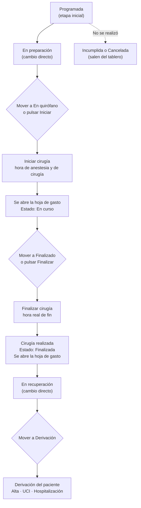
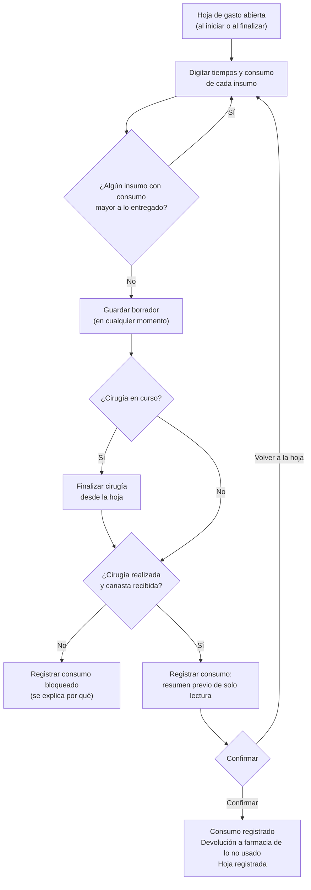

# Documentación funcional — Clintos

## Panel general de Cirugía

**Propósito:** portada del módulo de Cirugía. Resume la jornada quirúrgica (hoy, la semana o el mes) y permite seguir cada cirugía desde que está programada hasta que el paciente sale del quirófano: iniciarla y finalizarla, registrar la hoja de gasto, moverla entre las etapas del día (tablero), derivar al paciente y, si hace falta, reprogramarla o cancelarla. Existe para el equipo que coordina y opera el día en las salas (coordinación de quirófano, enfermería quirúrgica y circulante), con acciones de gestión para Programación de cirugía.

**Ruta:** `/cirugia` (menú Cirugía → Panel general). Con `?vista=tablero` abre directamente el tablero por estado; sin parámetro abre la tabla. Crear una cirugía no se hace aquí: vive en Programación sala de cirugías.

**Roles** (confirmados por grupo de acciones; hoy el sistema no aplica permisos por rol: la sesión es un usuario de ejemplo, "Administrador"):

| Grupo de acciones | Rol |
|---|---|
| Iniciar cirugía, finalizar cirugía, registrar la hoja de gasto | Circulante y Enfermería quirúrgica |
| Mover cirugías entre las etapas del tablero y derivar al paciente | Coordinación de quirófano y Enfermería quirúrgica |
| Reprogramar, cancelar, marcar como realizada o incumplida, pedir insumos, vincular personal y equipos | Programación de cirugía |
| Exportar la tabla, abrir la pantalla de familiares y ver el detalle de una cirugía | Coordinación de quirófano |

**Por confirmar:** el acceso de solo consulta a los indicadores, la tabla y el tablero para los demás roles. Se asume que quien actúa sobre una cirugía puede verla, pero no se definió por rol.

**Estados que se ven en el panel** (el sistema guarda cinco estados; los demás se derivan de la hora y de si la cirugía ya se inició):

| Estado visual | Cuándo aplica |
|---|---|
| Pendiente | Cirugía abierta (programada o de urgencia), sin iniciar, cuya hora de inicio aún no llega. |
| En curso | Cirugía con hora real de inicio registrada y sin finalizar. |
| Retrasada | Cirugía abierta, sin iniciar, cuya hora de inicio ya pasó (o es de un día anterior). No es un estado guardado: se calcula. |
| Finalizada | Cirugía cerrada como realizada. |
| Cancelada | Cirugía dada de baja con un motivo. |
| Incumplida | Cirugía programada que no se realizó y se marcó así. |

**Etapas del tablero** (describen dónde va el paciente el día de la cirugía; son un dato aparte del estado): Programada · En preparación · En quirófano · Finalizado · En recuperación · Derivación. La etapa "Admitido" existe en el sistema pero está oculta: llegar al hospital queda implícito al pasar a "En preparación".

---

### Flujo de una cirugía durante el día

Recorrido de una cirugía en el panel, con las acciones que dispara cada paso. En la tabla, el botón "Iniciar" e "Finalizar" cumplen el mismo papel que mover la tarjeta a "En quirófano" o "Finalizado" en el tablero.



### Flujo de la hoja de gasto y del cierre de la cirugía



### Ver los indicadores del panel

- **Qué hace:** muestra cinco indicadores del rango elegido (Hoy, Semana o Mes): Programadas, En curso, Finalizadas, Canceladas y Ocupación de salas.
- **Roles con acceso:** Coordinación de quirófano (consulta; ver "Por confirmar" arriba).
- **Reglas de negocio:**
  - **Programadas:** total de cirugías del rango, de todas las salas de la sede, sin importar su estado.
  - **En curso:** cirugías iniciadas y sin finalizar; indica en cuántas salas están ("En 2 salas") o "Ninguna en este momento".
  - **Finalizadas:** cirugías realizadas. **Canceladas:** suma las canceladas y las incumplidas.
  - **Ocupación de salas:** minutos de cirugía (sin canceladas ni incumplidas) sobre la capacidad de las salas activas, con una jornada de 12 horas por día y por sala; se limita a 100 %. Una sala en mantenimiento no cuenta como capacidad. Muestra además "X/Y salas con cirugías" y una barra de avance.
  - Los cuatro primeros indicadores también son filtros: al pulsar uno se filtra la tabla o el tablero por ese estado, y pulsarlo de nuevo lo quita. "Programadas" equivale a "todas". "Ocupación" solo informa.
  - Los textos se adaptan al rango ("Programadas hoy", "Programadas esta semana", "Programadas este mes").

### Ver las cirugías en tabla

- **Qué hace:** lista las cirugías del rango, ordenadas por fecha y hora de inicio, con hora (o fecha y hora si el rango no es "Hoy"), sala, duración, paciente, procedimiento, si tiene canasta vinculada, en qué punto va su pedido de canasta a farmacia, estado y acciones. Clic o Enter en una fila abre el detalle; un segundo clic sobre la misma fila la deselecciona.
- **Roles con acceso:** Coordinación de quirófano (consulta); las acciones de cada fila tienen su propio rol (ver abajo).
- **Reglas de negocio:**
  - Se consultan todas las salas de la Sede Norte; no hay selector de sede.
  - Una cirugía de urgencia lleva una etiqueta "Urgencia" junto al procedimiento.
  - **Canasta vinculada:** "Vinculada" si la cirugía tiene insumos asignados, "No vinculada" si no.
  - **Canasta pedida:** sin canasta vinculada muestra "—"; con canasta muestra el punto en que va el pedido a farmacia: No pedida, En preparación, Despachada, Despacho parcial, Recibida, Con novedades o Consumo registrado.
  - **Acciones por fila:** abierta y sin iniciar → "Iniciar" y el menú "⋯"; en curso → "Hoja de gasto", "Finalizar" y el menú "⋯"; realizada → "Ir a HC" y el menú "⋯"; canceladas e incumplidas solo tienen el menú "⋯" (con todo deshabilitado).
  - Si no hay cirugías en el rango se avisa "No hay cirugías programadas hoy" (o "esta semana" / "este mes"); si hay pero los filtros no dejan ninguna, "Ninguna cirugía coincide con los filtros" con el botón "Limpiar filtros".
  - Mientras se cargan los datos se muestra "Cargando cirugías…".

### Buscar y filtrar las cirugías

- **Qué hace:** acota lo que se ve en la tabla y en el tablero.
- **Roles con acceso:** Coordinación de quirófano (consulta).
- **Reglas de negocio:**
  - **Búsqueda:** por nombre del paciente, documento, procedimiento o cirujano; ignora mayúsculas.
  - **Rango de fechas:** Hoy (por defecto), Semana (lunes a domingo) o Mes en curso. Cambiar el rango vuelve a cargar los datos y vuelve a la página 1 de la tabla.
  - **Estado:** Todos los estados, Pendiente, En curso, Retrasada, Finalizada, Cancelada o Incumplida.
  - **Más filtros** (ventana con borrador: los cambios solo se aplican al pulsar "Aplicar"): sala de cirugía (una sola o todas), canasta vinculada (Vinculada, No vinculada; sin marcar = sin filtro) y canasta pedida (una sola o todas).
  - Los filtros de los indicadores y el de estado se combinan entre sí.
  - "Limpiar filtros" aparece solo cuando hay algún filtro activo y la lista quedó vacía.

### Paginar la tabla

- **Qué hace:** el pie de la tabla muestra "Mostrando X–Y de N cirugías" y permite cambiar de página y cuántas filas ver por página.
- **Roles con acceso:** Coordinación de quirófano (consulta).
- **Reglas de negocio:**
  - Opciones de filas por vista: 10, 20 y 50; 20 por defecto.
  - Cambiar cualquier filtro, el rango o las filas por vista vuelve a la página 1.
  - El pie no aparece en el tablero.
  - Exportar siempre lleva todas las filas filtradas, no solo la página visible.

### Exportar la tabla

- **Qué hace:** descarga un archivo CSV con las cirugías que muestra la tabla (con los filtros aplicados).
- **Roles con acceso:** Coordinación de quirófano.
- **Reglas de negocio:**
  - Solo está disponible en la vista Tabla y se deshabilita si no hay filas.
  - Columnas: Hora, Sala, Paciente, Documento, Procedimiento, Anestesia, Cirujano, Duración (min), Canasta vinculada, Canasta pedida y Estado.
  - El archivo se llama `cirugias-<rango>-<fecha>.csv`.
  - Es el único lugar del panel que incluye el documento del paciente; la tabla no lo muestra.

### Ver el tablero por estado

- **Qué hace:** muestra las cirugías como tarjetas en columnas, una por etapa del día, con el número de cirugías de cada columna. Cada tarjeta indica la sala (y el día si el rango no es "Hoy"), el horario, el paciente, el procedimiento y el cirujano.
- **Roles con acceso:** Coordinación de quirófano y Enfermería quirúrgica.
- **Reglas de negocio:**
  - Seis columnas visibles: Programada, En preparación, En quirófano, Finalizado, En recuperación y Derivación.
  - Las canceladas y las incumplidas no aparecen en el tablero.
  - Sin etapa guardada, la etapa se deduce: realizada → Finalizado; con hora real de inicio → En quirófano; el resto → Programada.
  - Una tarjeta de la columna Programada con la hora ya pasada lleva la etiqueta "Retrasada"; una tarjeta en Derivación muestra el destino (Alta, UCI u Hospitalización).
  - Una columna vacía invita a "Arrastra una cirugía aquí".
  - Usa el mismo rango, búsqueda y filtros que la tabla. Clic en una tarjeta abre el detalle.
  - Se puede abrir con `?vista=tablero`, útil para dejarlo fijo en una pantalla de coordinación.

### Mover una cirugía entre las etapas del tablero

- **Qué hace:** arrastrar una tarjeta a otra columna, o usar "Mover a …" en el menú "⋯" de la tarjeta (alternativa por teclado), cambia su etapa.
- **Roles con acceso:** Coordinación de quirófano y Enfermería quirúrgica.
- **Reglas de negocio:**
  - El movimiento es libre, hacia adelante o hacia atrás, para corregir errores, salvo donde hay un dato real que registrar.
  - **A "En quirófano" sin inicio real:** abre "Iniciar cirugía"; la tarjeta no cambia de columna hasta confirmarlo.
  - **A "Finalizado":** si la cirugía está en curso, abre "Finalizar cirugía"; si no se ha iniciado, se bloquea con el aviso "Para finalizar la cirugía primero debe iniciarse: muévela a «En quirófano»".
  - **A "Derivación":** abre la ventana de derivación (ver más abajo).
  - **A cualquier otra etapa:** cambio directo, con aviso "Cirugía movida a «…»".
  - Soltar la tarjeta en la misma columna no hace nada.
  - Las canceladas e incumplidas no se pueden mover.
  - El arrastre funciona con mouse (con un desplazamiento mínimo para no confundirlo con un clic) y con pulsación corta en pantallas táctiles.
  - Cuando se marca una cirugía como realizada desde el menú y aún no había avanzado a recuperación o derivación, pasa sola a "Finalizado".

### Derivar al paciente

- **Qué hace:** al mover una cirugía a "Derivación", pide a dónde va el paciente: Alta, UCI u Hospitalización.
- **Roles con acceso:** Coordinación de quirófano y Enfermería quirúrgica.
- **Reglas de negocio:**
  - El destino es obligatorio; "Derivar" se habilita al elegirlo.
  - El destino queda guardado en la cirugía y se muestra en su tarjeta.
  - Se puede volver a derivar para cambiar el destino (la ventana abre con el destino actual).
  - Escape cierra la ventana sin mover la tarjeta.

### Configurar la vista

- **Qué hace:** el botón "Configuración de vista" (ícono de ajustes, al final de la barra de filtros) cambia entre Tabla y Tablero y define el tipo de vista de los indicadores.
- **Roles con acceso:** Coordinación de quirófano.
- **Reglas de negocio:**
  - **Vista:** Tabla (por defecto) o Tablero. La elección se refleja en la dirección (`?vista=tablero`), por eso se puede compartir o dejar fija.
  - **Tipo de vista:** Compacto (por defecto) muestra cada indicador en una línea y le deja más alto a la tabla o al tablero; Expandido muestra tarjetas completas con descripción y barra de ocupación. Cambiar el tipo no cierra el menú.
  - El tipo de vista no se recuerda al recargar; vuelve a Compacto.

### Iniciar una cirugía

- **Qué hace:** registra el inicio real de una cirugía. Se abre desde el botón "Iniciar" de la fila o al mover la tarjeta a "En quirófano". Pide dos horas, editables: **inicio de anestesia** (se propone 15 minutos antes) e **inicio de cirugía** (se propone la hora actual). Al confirmar, la cirugía queda "En curso" y se abre la hoja de gasto.
- **Roles con acceso:** Circulante y Enfermería quirúrgica.
- **Reglas de negocio:**
  - Ambas horas son obligatorias y la anestesia no puede ser posterior a la cirugía; si lo es, se avisa y no se puede confirmar.
  - Ambas horas quedan registradas en la hoja de gasto ("Inicio anestesia" e "Inicio cirugía").
  - **El botón "Iniciar" se deshabilita, con el motivo en un aviso al pasar el cursor, cuando:** la cirugía ya está en curso; no está programada ni es de urgencia; no es del día de hoy; la canasta no está recibida; la sala ya tiene otra cirugía en curso; o, para una programada, faltan más de 30 minutos para su hora.
  - **Restricción por hora:** la regla de los 30 minutos depende del ajuste del sistema "Restringir el inicio de cirugías por hora" (Configuración → Clínico), que viene activo. Apagarlo permite iniciar cualquier cirugía del día sin esperar. No aplica a las de urgencia.
  - Solo se puede iniciar una cirugía a la vez por sala.

### Finalizar una cirugía

- **Qué hace:** registra el fin real de una cirugía en curso. Se abre desde el botón "Finalizar" de la fila, al mover la tarjeta a "Finalizado" o desde la propia hoja de gasto. Pide la hora real de fin (se propone la hora actual). Al confirmar, la cirugía queda realizada, el fin se registra en la hoja y esta se abre para registrar el consumo.
- **Roles con acceso:** Circulante y Enfermería quirúrgica.
- **Reglas de negocio:**
  - La hora de fin es obligatoria y no puede ser anterior al inicio real.
  - Solo se puede finalizar una cirugía en curso.
  - Si se finaliza desde la hoja, esta sigue abierta con la cirugía ya realizada, para registrar el consumo sin salir.
  - Una vez realizada, ya no se puede editar, reprogramar ni cancelar.

### Registrar la hoja de gasto quirúrgico

- **Qué hace:** la "Hoja de gasto quirúrgico" (hoja de consumo del centro quirúrgico) registra los tiempos de la cirugía y el material usado. A la izquierda va el formulario (equipo de la cirugía, en solo lectura, y los tiempos: inicio de anestesia, inicio de cirugía y fin de cirugía, con un contador de la duración de la operación); a la derecha, el paquete de insumos, el progreso del consumo y la tabla de insumos con la cantidad consumida. Arriba, una barra con el paciente, el procedimiento (CUPS) y el diagnóstico (CIE-10). En pantallas de tablet los insumos van primero y el formulario queda plegado debajo.
- **Roles con acceso:** Circulante y Enfermería quirúrgica.
- **Reglas de negocio:**
  - La hoja se abre desde "Hoja de gasto" en una cirugía en curso, al iniciar y al finalizar la cirugía, y desde el detalle de una cirugía realizada.
  - **Guardar borrador** conserva lo digitado en cualquier momento; la hoja queda marcada como "Borrador".
  - **Consumo por insumo:** se digita con botones − y + o escribiéndolo, entre 0 y lo entregado. El devuelto es lo entregado menos lo consumido. Un consumo mayor a lo entregado es un error: se avisa y no deja registrar. Hay un atajo "Todo consumido".
  - **Contador de la operación:** sin inicio de cirugía invita a registrarlo; con inicio y sin fin corre en vivo; con fin muestra la duración total.
  - **Registrar consumo** abre primero un resumen de solo lectura; nada se registra hasta pulsar "Confirmar", y "Volver a la hoja" (o Escape) regresa sin registrar.
  - **Solo se puede registrar el consumo** con la cirugía **realizada** y su **canasta recibida**. Con la cirugía en curso, el botón no aparece y se indica finalizar primero; si la cirugía no está realizada o la canasta no está recibida, el pie explica el motivo.
  - Al confirmar, en una sola acción: se registra el consumo de la canasta, se genera la **devolución a farmacia** de lo no consumido (con su número consecutivo) y la hoja queda "registrada", disponible para la firma de farmacia. Los insumos de la canasta que no aparecen en la hoja se registran como usados completos.
  - Si el consumo de la canasta ya se había registrado desde Canastas de cirugía, solo se guarda la hoja, sin una segunda devolución.
  - Una hoja registrada se vuelve a abrir como resumen de solo lectura, con la opción "Imprimir / Guardar PDF".
  - Un aviso informa cuántas unidades se devolverán y en cuántos insumos, o que no hay nada por devolver.

### Ver el detalle de una cirugía

- **Qué hace:** abre el modal "Detalle de la cirugía" con los datos del paciente, la programación, los procedimientos y las pestañas Insumos, Personal clínico y Equipos. Es el mismo detalle de Programación sala de cirugías (ver su documento), con una diferencia: aquí no se ofrece "Editar".
- **Roles con acceso:** Coordinación de quirófano.
- **Reglas de negocio:**
  - Cancelar y Reprogramar siguen disponibles, deshabilitados si la cirugía está en curso o en un estado final.
  - Una cirugía **realizada** muestra su resultado y su cierre: el balance de insumos (entregado, usado y devuelto) y la línea de tiempo del cierre, con acceso a las hojas de consumo. Lo único accionable es lo que falte cerrar (registrar el consumo).
  - Desde la pestaña Insumos se pide la canasta a farmacia, se anula la solicitud o se va a Canastas de cirugía (ver Programación sala de cirugías); desde Personal clínico y Equipos se vinculan y editan. Esas acciones corresponden a Programación de cirugía.
  - Escape cierra el modal; con una ventana abierta encima, Escape cierra solo esa ventana.

### Reprogramar, cancelar y marcar una cirugía como realizada o incumplida

- **Qué hace:** desde el menú "⋯" de la fila o de la tarjeta, y desde el detalle: Reprogramar, Marcar como realizada, Marcar como incumplida y Cancelar. En el panel el menú no incluye "Editar".
- **Roles con acceso:** Programación de cirugía.
- **Reglas de negocio:**
  - Las reglas, las causales y los avisos son los mismos de Programación sala de cirugías (ver su documento): reprogramar exige causal, fecha, hora, sala y cirujano; cancelar exige motivo; "incumplida" solo aplica a una cirugía programada cuya hora ya pasó y que no está en curso.
  - Reprogramar, Editar y Cancelar se deshabilitan con la cirugía en curso o en un estado final.
  - Marcar como realizada está disponible hasta en una cirugía en curso y, si aún no avanzó, la lleva a la etapa "Finalizado". Si farmacia tiene un saldo pendiente de la canasta, se avisa que la solicitud sigue abierta (solo advierte).
  - Cuando una cirugía se reprograma o se cancela y queda fuera del rango del panel, sale de la lista sin volver a cargarla.
  - Marcar como realizada no registra la hora real ni la hoja de gasto: para eso existe "Finalizar".

### Ir a la Historia clínica de cirugía

- **Qué hace:** en una cirugía realizada, el botón "Ir a HC" lleva a la pantalla de Historia clínica de cirugía.
- **Roles con acceso:** por confirmar (el rol clínico que registra la historia no se definió para esta acción).
- **Reglas de negocio:**
  - Solo aparece en cirugías realizadas que no están en curso.
  - Hoy lleva al listado de Historia clínica de cirugía, no a la historia de ese paciente en particular.

### Abrir la pantalla de familiares

- **Qué hace:** el botón "Pantalla de familiares" abre, en una ventana grande sobre el panel, una vista pensada para proyectar en el televisor de la sala de espera: lista las cirugías del día con un código, el nombre abreviado, la hora programada y un estado en palabras para una familia.
- **Roles con acceso:** Coordinación de quirófano.
- **Reglas de negocio:**
  - **Privacidad:** solo muestra el código de la cirugía, el nombre abreviado del paciente ("Laura G."), la hora programada y el estado. Nunca diagnóstico, procedimiento, cirujano, documento ni sala.
  - **Estado en palabras** (sale de la etapa de la cirugía en el tablero, por lo que mover una tarjeta actualiza la pantalla): En preparación, En cirugía, En recuperación, Cirugía finalizada y, para la derivación, "Con el equipo médico" (el destino es un dato clínico y no se muestra).
  - No se muestran las programadas, las canceladas ni las incumplidas.
  - Primero van las cirugías en curso (preparación, cirugía, recuperación) y luego las ya cerradas, cada grupo por hora programada.
  - Se actualiza cada 5 segundos y, si hay más de 7 filas, rota de página cada 10 segundos.
  - Además de la ventana del panel, existe una ruta pública para el televisor (`/pantalla-familiares`), con tema oscuro y una clave de acceso de demostración que solo evita abrirla por accidente.

---

## Notas generales y límites conocidos

- **Prototipo con datos en memoria:** las cirugías, las horas reales, las hojas de gasto y las devoluciones viven en el navegador y se pierden al recargar la página. Los catálogos (salas, médicos, canastas, causales) son datos de ejemplo.
- **Permisos:** no existe control de acceso por rol; los roles documentados son los definidos para el producto, no uno que el sistema verifique hoy.
- **Hora del sistema en la demo:** las reglas que dependen de "ahora" (estado Pendiente o Retrasada, cuándo se puede iniciar una cirugía, cuándo marcarla incumplida) usan una hora fija de demostración (08:45 del día actual), no el reloj real.
- **Sede única:** el panel opera siempre sobre la Sede Norte; no hay selector de sede.
- **Datos sin actualización automática:** el panel carga las cirugías al abrirse y al cambiar de rango; los cambios que otra persona haga en otro equipo no aparecen hasta recargar. Lo mismo ocurre con la pantalla de familiares de un televisor con su propio navegador (hoy no hay servidor que comparta el estado).
- **Etapa "Admitido" oculta:** existe en el modelo, pero no se muestra en el tablero ni se puede elegir.
- **"Ir a HC" es genérico:** lleva al listado de Historia clínica de cirugía, no a la historia del paciente de la fila.
- **Detalle sin edición:** desde el panel no se puede editar una cirugía; eso se hace en Programación sala de cirugías.

---

## Prompt para crear el front de esta pantalla

Brief para un diseñador o desarrollador que deba construir (o reconstruir) la pantalla desde cero. Es autocontenido: no depende del código existente.

```text
Necesito diseñar y construir la pantalla "Panel general de Cirugía" de un sistema clínico hospitalario (producto Clintos). Es la portada del módulo de Cirugía y la usa el equipo que coordina y opera las salas de quirófano durante el día. Todo el texto de la interfaz va en español.

OBJETIVO
Que quien coordina el día entienda de un vistazo cómo van las cirugías (cuántas hay, cuáles están en curso, cuáles se atrasaron, qué tan ocupadas están las salas) y pueda actuar sobre cada una sin salir de la pantalla: iniciarla, finalizarla, registrar el gasto de insumos, moverla entre etapas, derivar al paciente, reprogramarla o cancelarla.

USUARIOS Y PERMISOS
- Circulante y enfermería quirúrgica: iniciar, finalizar y registrar la hoja de gasto.
- Coordinación de quirófano y enfermería quirúrgica: mover cirugías entre etapas y derivar.
- Programación de cirugía: reprogramar, cancelar, marcar como realizada o incumplida.
- Coordinación de quirófano: exportar, abrir la pantalla de familiares y ver el detalle.
Los controles que un rol no puede usar deben verse deshabilitados, con el motivo en un aviso al pasar el cursor, nunca ocultos sin explicación.

ESTRUCTURA GENERAL (escritorio, 1025 px o más)
Dentro del marco de la aplicación (barra lateral azul a la izquierda y barra superior con migas de pan "Cirugía > Panel general"), el contenido se apila en tres bloques que ocupan todo el alto y no hacen scroll de página; solo scrollea el interior de la tarjeta de la lista.

1) Encabezado de página
- Título "Panel general - Cirugías" y debajo "Estado de las salas y programación quirúrgica del día."
- A la derecha, dos botones secundarios con ícono: "Pantalla de familiares" (ícono de televisor) y "Exportar" (ícono de descarga). "Exportar" solo existe en la vista Tabla y se deshabilita si no hay filas.

2) Fila de 5 indicadores (tarjetas con ícono, etiqueta, valor y descripción)
- "Programadas hoy" (neutro): total de cirugías; descripción "Cirugías en agenda".
- "En curso" (informativo, azul): cantidad; descripción "En 2 salas" o "Ninguna en este momento".
- "Finalizadas" (éxito, verde): cantidad; descripción "Cirugías realizadas hoy".
- "Canceladas" (peligro, rojo): suma de canceladas e incumplidas; descripción "Canceladas o incumplidas".
- "Ocupación de salas" (neutro): porcentaje grande, descripción "3/5 salas con cirugías" y una barra de progreso.
- Las cuatro primeras son botones de filtro tipo interruptor: al pulsar una se resalta (estado activo) y filtra la lista; al pulsarla otra vez se quita. "Ocupación" solo informa.
- Dos densidades: Compacto (por defecto; cada indicador en una sola línea: ícono y etiqueta a la izquierda, valor a la derecha, sin descripción ni barra, para darle alto a la lista) y Expandido (tarjeta completa). En tablet (768 a 1024 px) la fila pasa a 3 columnas.
- El texto "hoy" cambia a "esta semana" o "este mes" según el rango elegido.

3) Tarjeta principal (fondo blanco, borde fino, esquinas redondeadas de 12 px) con tres partes:
a) Barra de herramientas en UNA sola fila, de izquierda a derecha:
   - Buscador con lupa y placeholder "Buscar paciente, procedimiento..." (botón para limpiar cuando hay texto).
   - Espacio flexible que empuja el resto a la derecha.
   - Selector segmentado "Hoy | Semana | Mes" (hoy activo por defecto).
   - Selector desplegable "Todos los estados" (190 px) con: Todos los estados, Pendiente, En curso, Retrasada, Finalizada, Cancelada, Incumplida.
   - Botón "Más filtros" que abre un panel flotante con: Sala de cirugía (selector), Canasta vinculada (casillas "Vinculada" y "No vinculada") y Canasta pedida (selector con No pedida, En preparación, Despachada, Despacho parcial, Recibida, Con novedades, Consumo registrado). Los cambios se editan en un borrador y solo se aplican al pulsar "Aplicar". Los desplegables internos no deben cerrar el panel al elegir una opción.
   - Botón de solo ícono (ajustes) "Configuración de vista" que abre un menú con dos grupos: "Vista" (Tabla, Tablero) y "Tipo de vista" (Compacto, Expandido), con check en la opción activa. Cambiar el tipo no cierra el menú.
   Todos los controles miden 36 px de alto.
b) Contenido: la Tabla o el Tablero (ver abajo).
c) Pie (solo en Tabla): a la izquierda el conteo ("Mostrando 1–20 de N cirugías"); a la derecha, agrupados en este orden, el selector "filas por vista" (10, 20, 50; 20 por defecto) y la paginación (anterior, números con puntos suspensivos, siguiente).

VISTA TABLA
Columnas: Hora (o "Fecha y hora" si el rango no es Hoy) · Sala · Duración (alineada a la derecha, "90 min") · Paciente · Procedimiento · Canasta vinculada · Canasta pedida · Estado · Acciones.
- Encabezado fijo al hacer scroll, texto de 12 px en seminegrita, sin mayúsculas, fondo gris muy claro.
- Fila clicable y enfocable con teclado (Enter abre el detalle); la fila seleccionada se resalta. No mostrar el documento del paciente.
- Procedimiento: si la cirugía es de urgencia, una etiqueta ámbar "Urgencia" a su lado.
- Canasta vinculada: etiqueta verde "Vinculada" o gris "No vinculada".
- Canasta pedida: "—" si no hay canasta; si la hay, una etiqueta por estado (No pedida y En preparación en gris; Despachada en azul; Despacho parcial y Con novedades en ámbar; Recibida en verde; Consumo registrado en violeta).
- Estado: etiqueta con ícono y texto (nunca solo color): Pendiente (gris, reloj), En curso (azul, pulso cardíaco), Retrasada (ámbar, cronómetro), Finalizada (verde, check), Cancelada (rojo, X), Incumplida (gris, calendario tachado).
- Acciones (alineadas a la derecha, sin que el clic seleccione la fila): según la cirugía, uno de estos grupos y siempre al final el menú "⋯" de 28 px:
  · Abierta y sin iniciar: botón pequeño primario "Iniciar" (ícono de play). Si no se puede iniciar, se ve deshabilitado y el motivo aparece en un aviso al pasar el cursor.
  · En curso: botón pequeño de contorno "Hoja de gasto" (ícono de portapapeles) y botón pequeño primario "Finalizar" (ícono de check).
  · Realizada: botón pequeño de contorno "Ir a HC" (ícono de documento).
  · Cancelada o incumplida: solo el menú, con todo deshabilitado.
- Menú "⋯" (se despliega sobre todo, sin que lo recorte el scroll de la tabla): Reprogramar · Marcar como realizada · Marcar como incumplida · Cancelar (en rojo, con separadores entre grupos). Cada ítem lleva ícono y se deshabilita según el estado de la cirugía.
- Estados vacíos centrados: "Cargando cirugías…", "No hay cirugías programadas hoy." y "Ninguna cirugía coincide con los filtros." con botón "Limpiar filtros".

VISTA TABLERO (columnas por etapa)
- Seis columnas con el mismo ancho y scroll horizontal si no caben: Programada · En preparación · En quirófano · Finalizado · En recuperación · Derivación. Cada encabezado muestra el nombre y un contador redondo.
- Dentro de cada columna, tarjetas de cirugía: arriba una línea pequeña con la sala (y el día corto si el rango no es Hoy); debajo la tarjeta con horario, paciente, procedimiento y cirujano, y el menú "⋯" que solo se ve al pasar el cursor.
- En la columna Programada, si la hora ya pasó, una etiqueta roja con punto "Retrasada". En Derivación, una etiqueta azul con el destino (Alta, UCI u Hospitalización).
- Columna vacía: texto tenue "Arrastra una cirugía aquí".
- Arrastrar y soltar entre columnas (mouse con un umbral de 6 px para no confundir con un clic; táctil con pulsación larga de 250 ms). Mientras se arrastra, la columna destino se resalta y la tarjeta original queda atenuada. Como alternativa por teclado, el menú "⋯" ofrece "Mover a …" para cada otra etapa.
- Soltar la tarjeta no la cambia de columna hasta que el modal que se abra se confirme.
- Las canceladas e incumplidas no aparecen. La vista admite la dirección "?vista=tablero".

REGLAS AL MOVER UNA TARJETA
- A "En quirófano" sin inicio real: abre el modal "Iniciar cirugía".
- A "Finalizado": si está en curso, abre "Finalizar cirugía"; si no se inició, no se mueve y se avisa "Para finalizar la cirugía primero debe iniciarse: muévela a «En quirófano»".
- A "Derivación": abre el modal "Derivación del paciente".
- A cualquier otra: cambia de columna y avisa "Cirugía movida a «…»".
- Mover hacia atrás está permitido (corregir errores).

MODALES (todos con encabezado de 16 px 24 px: ícono opcional en círculo de 34 px, título en seminegrita, botón de cerrar de 30 px; Escape cierra; foco atrapado dentro)
1. Iniciar cirugía: tarjeta de contexto (paciente, procedimiento, sala, horario programado), dos campos de hora obligatorios en orden cronológico "Inicio de anestesia" (se propone 15 minutos antes) e "Inicio de cirugía" (se propone la hora actual). Error en línea si la anestesia es posterior a la cirugía. Nota informativa: los tiempos quedan en la hoja de gasto, que se abrirá al iniciar. Botones "Volver" y "Iniciar cirugía" (con play).
2. Finalizar cirugía: misma estructura; muestra el inicio real y pide "Hora real de fin" (obligatoria, no anterior al inicio real). Botones "Volver" y "Finalizar cirugía".
3. Derivación del paciente: un selector "Destino" (Alta, UCI, Hospitalización), obligatorio. Botones "Cancelar" y "Derivar".
4. Detalle de la cirugía: modal grande con el estado en el encabezado; franja del paciente (nombre con avatar de iniciales, documento, edad, sexo, aseguradora, teléfono de aviso, con "ver más datos"); a la izquierda "Programación" (fecha y hora con el formato 21.AGO.2026 - 07:00), la lista de procedimientos y los botones "Cancelar cirugía", "Reprogramar"; a la derecha pestañas "Insumos", "Personal clínico" y "Equipos" (con flechas del teclado). Si la cirugía está realizada, cambia a una vista de resultado y cierre con el balance de insumos (entregado, usado, devuelto) y una línea de tiempo.
5. Reprogramar cirugía: causal (catálogo, obligatorio), nueva fecha, nueva hora de inicio, nueva sala, nuevo cirujano. Botones "Cancelar" y "Reprogramar" (deshabilitado hasta completar todo).
6. Cancelar cirugía: pregunta "¿Deseas cancelar esta cirugía?" y un campo "Motivo de cancelación" obligatorio; botones "Volver" y "Cancelar cirugía" (peligro).
7. Hoja de gasto quirúrgico: modal ancho con encabezado "Nueva hoja de gasto quirúrgico" y etiqueta "Borrador"; barra de contexto de una línea (paciente a la izquierda; a la derecha procedimiento y diagnóstico, recortados con "…"); cuerpo en dos columnas (izquierda: equipo en solo lectura y tres tiempos editables con un contador de la operación que corre en vivo; derecha: nombre del paquete, progreso del consumo y tabla de insumos con la cantidad entregada, un control −/+ para lo consumido y lo devuelto calculado). Atajo "Todo consumido". Pie con una nota que explica qué va a pasar o por qué no se puede registrar, y los botones "Cancelar", "Guardar borrador", "Finalizar cirugía" (solo si está en curso) y "Registrar consumo" (oculto en curso; deshabilitado si hay exceso o la cirugía/canasta no lo permiten). "Registrar consumo" abre un resumen de solo lectura con "Volver a la hoja" y "Confirmar"; al confirmar se registra y se genera la devolución a farmacia. Una hoja ya registrada se reabre como resumen con "Imprimir / Guardar PDF". En tablet los insumos van primero y el formulario queda en acordeones cerrados.
8. Pantalla de familiares: ventana al 95 % del ancho y alto con una lista tipo tablero de aeropuerto (ver abajo).

PANTALLA DE FAMILIARES (para proyectar en un televisor)
- Lista a pantalla completa titulada "Estado de las cirugías", con un reloj con fecha y hora, y columnas Código, Paciente (nombre abreviado, "Laura G."), Hora (programada) y Estado. Texto muy grande para leerse a varios metros (usa una escala propia, no la del resto del sistema) y colores de estado con buen contraste. Existe versión clara (la ventana del panel) y oscura (la ruta pública del televisor).
- Estados en palabras: En preparación, En cirugía, En recuperación, Cirugía finalizada y "Con el equipo médico". Primero las cirugías en curso y luego las cerradas.
- PRIVACIDAD: jamás mostrar diagnóstico, procedimiento, cirujano, documento ni sala.
- Se refresca cada 5 s; si hay más de 7 filas, rota de página cada 10 s con puntos de página abajo.

SISTEMA VISUAL
- Tipografía: la del sistema (system-ui, Segoe UI, Helvetica, Arial). Escala fija: 11, 12, 14 (base), 16, 18, 20, 24 y 28 px. Pesos: 400 cuerpo, 500 énfasis, 600 todos los títulos y etiquetas, 700 solo cifras grandes de indicadores. Los títulos nunca van en negrita 700.
- Color: primario azul #0065CD (oscuro #004E9E, fondo claro #EEF4FF, selección #DBE8FE); tinta #101827 / #374151 / #6B7280; borde #E5E8EF; superficie #FFFFFF; fondo de página #F4F6FB. Éxito #12A150 sobre #E6F8EE (texto sobre fondo claro #0D7A3D); peligro #C02B2B sobre #FDECEB; ámbar #E08A00 sobre #FFF4E0 (texto #A45A05); violeta #6D3FD6 sobre #F1ECFF; informativo azul sobre #EEF4FF. El rojo se reserva para error o peligro. Nunca usar negro ni blanco puro para texto.
- Forma: radios de 8 px en controles y botones, 12 px en tarjetas, 20 px en etiquetas (badges). Una sola sombra para menús y paneles flotantes (0 8px 24px con 16 % de opacidad). Se prefiere borde fino sobre sombra en tarjetas.
- Botones: primario (azul sólido), secundario (blanco con borde), contorno, peligro y variante pequeña (32 px). Ícono a la izquierda del texto, 18 px (15 px en pequeño). Deshabilitado al 45 % de opacidad. Foco visible con contorno de 2 px azul separado 2 px.
- Etiquetas (badges): relleno suave de color con texto del mismo tono más oscuro, 11 px en seminegrita, padding 4 px 10 px; con punto de color opcional.
- Íconos: set Lucide, siempre acompañados de texto cuando comunican un estado.
- Fechas con hora: formato "21.AGO.2026 - 07:00".
- Espaciado en múltiplos de 4 px; separación entre indicadores de 16 px (12 px en compacto).

RESPONSIVE
- Escritorio (1025 px o más): como se describió.
- Tablet (768 a 1024 px): el contenido hace scroll de página, la tarjeta principal tiene al menos 480 px de alto, los indicadores van en 3 columnas, los objetivos táctiles (botones, filas, días) miden al menos 44 px. La hoja de gasto pone los insumos primero.
- Por debajo de 768 px no está en alcance.

ACCESIBILIDAD
- Todo se opera con teclado; las filas y tarjetas se activan con Enter o Espacio; los menús se recorren con flechas, Inicio y Fin, y Escape devuelve el foco al botón que los abrió.
- Los estados se comunican con ícono y texto, no solo con color. Los avisos de resultado (toasts) usan role="status" y desaparecen solos a los 2,6 s.
- Los modales atrapan el foco, tienen nombre accesible y se cierran con Escape; con una ventana encima de otra, Escape cierra solo la de arriba.

DATOS DE EJEMPLO PARA MAQUETAR
Sala (Quirófano #1, #2, #3 en mantenimiento, Gastroenterología, Hemodinamia, Proc. Menores), paciente, procedimiento, cirujano, hora de inicio y fin, estado (programada, urgencia, realizada, cancelada, incumplida), hora real de inicio y fin cuando existan, canasta con insumos y su estado de entrega, etapa del tablero y destino de derivación. Incluye casos límite: nombres largos, cirugía de urgencia, cirugía retrasada, cirugía en curso, rango Semana con muchos días, lista vacía y sin canasta.

ENTREGABLES
Maqueta navegable de escritorio y tablet con los dos modos (Tabla y Tablero), los dos tipos de vista de indicadores (Compacto y Expandido), los ocho modales y la pantalla de familiares, con los estados vacío, cargando, deshabilitado, foco y error de cada control.
```
