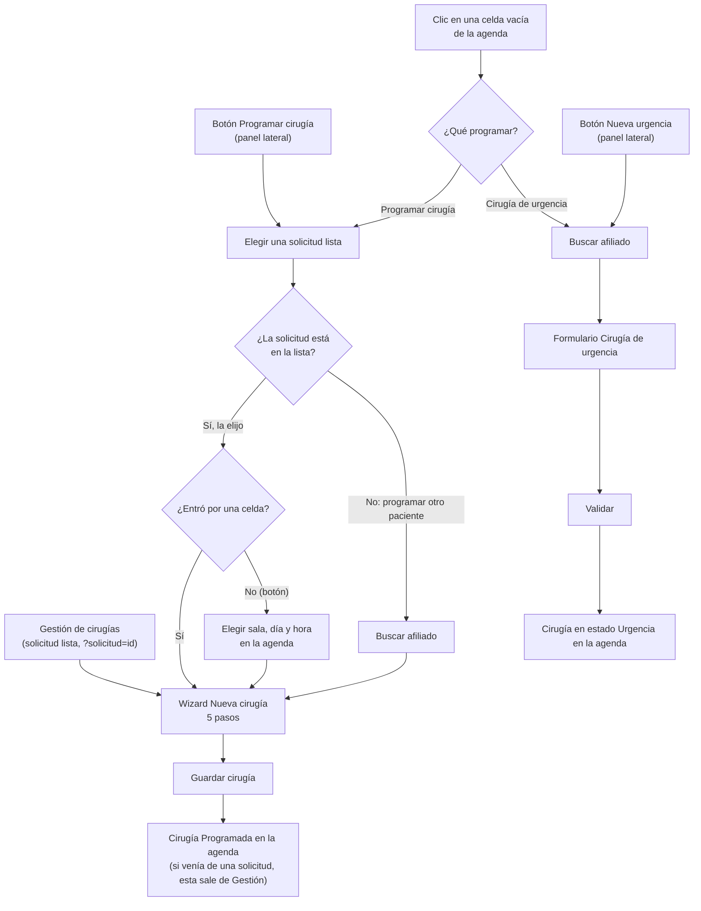

# Documentación funcional — Clintos

## Programación sala de cirugías

**Propósito:** agendar y gestionar la ocupación de las salas de cirugía: ver qué cirugías hay en cada sala (o por cirujano), programar nuevas cirugías (desde una solicitud lista de Gestión de cirugías, de un paciente cualquiera o de urgencia), ajustarlas (editar, reprogramar, cambiar su duración, cancelar), cerrarlas (realizada o incumplida) y dejar preparados su personal, equipos e insumos. Existe para el equipo de **Programación de cirugía**.

**Ruta:** `/cirugia/programacion` (menú Cirugía → Programación). Con `?solicitud=<id>` abre directamente el wizard de una solicitud lista (así llega desde Gestión de cirugías).

**Roles:** todas las funcionalidades de este submódulo las ejecuta el rol **Programación de cirugía** (confirmado). Igual que en Gestión de cirugías, hoy el sistema no aplica permisos por rol.

**Estados de una cirugía** (la leyenda del panel lateral los muestra):

| Estado | Qué significa |
|---|---|
| Programada | Cirugía agendada con fecha, hora y sala. Es el estado de toda cirugía creada con el wizard. |
| Urgencia | Cirugía creada con el flujo corto de urgencia. |
| Realizada | Cirugía cerrada como realizada. Es un estado final. |
| Cancelada | Cirugía dada de baja con un motivo. Es un estado final y deja de ocupar la sala. |
| Incumplida | Cirugía programada cuya hora pasó sin realizarse. Es un estado final y deja de ocupar la sala. |

Una cirugía **en curso** no es un estado aparte: es una programada o de urgencia con hora real de inicio registrada (la inicia el Panel general, no esta pantalla). Una cirugía **vencida** es una programada cuya fecha ya pasó sin cerrarse.

**Qué se puede hacer según el estado:**

| Acción | Programada / Urgencia | En curso | Realizada, Cancelada, Incumplida |
|---|---|---|---|
| Editar, Reprogramar, Cancelar | Sí | No | No |
| Ajustar la duración (arrastrar) | Sí | No | No |
| Marcar como realizada | Sí | Sí | No |
| Marcar como incumplida | Solo Programada, y si su hora de inicio ya pasó | No | No |
| Vincular canasta, personal y equipos; pedir insumos | Sí | No | No |

---

### Flujo para programar una cirugía

Hay cuatro puertas de entrada. Todas terminan en el mismo wizard "Nueva cirugía", salvo la urgencia, que tiene su propio formulario corto.

### Ver la agenda

- **Qué hace:** muestra las cirugías de una sala (o de un cirujano) en una grilla de calendario con franjas de 30 minutos. Cada cirugía es una tarjeta ubicada en su día, hora y duración, con el nombre del paciente, el procedimiento y el cirujano (si la tarjeta es de una hora o menos, solo el nombre del paciente). Arranca en la semana de hoy, en la sala Quirófano #1.
- **Roles con acceso:** Programación de cirugía.
- **Reglas de negocio:**
  - **Días visibles:** Día, Semana completa, Semana hábil (lunes a viernes, por defecto) o 3 días hábiles (hoy más los 2 siguientes). La vista Mes existe pero no se ofrece en el selector.
  - **Horas visibles:** jornada operativa (07:00–19:00, por defecto) o 24 horas. Es solo de visualización: una cirugía fuera de la ventana visible no se dibuja, pero sigue existiendo y cuenta en los totales.
  - Se opera siempre sobre la Sede Norte; no hay selector de sede.
  - Una sala en mantenimiento aparece en el catálogo de salas pero no tiene cirugías.
  - Clic en una tarjeta la selecciona y abre su detalle. Los atajos de teclado D (Día) y S (Semana completa) cambian la vista.

### Ver la agenda en formato tabla

- **Qué hace:** muestra las mismas cirugías del rango activo en una tabla, una por fila, con fecha, hora, sala (cuando se ven todas las salas), paciente, procedimiento, médico (en la agenda por médicos), duración y estado, más un menú "⋯" de acciones.
- **Roles con acceso:** Programación de cirugía.
- **Reglas de negocio:**
  - El selector "Calendario / Tabla" está en la barra de filtros. Los filtros, la navegación y el rango son los mismos que en el calendario.
  - El menú de acciones de cada fila aplica las mismas reglas de la tabla "Qué se puede hacer según el estado".

### Navegar y filtrar la agenda

- **Qué hace:** cambia qué cirugías se ven: por sala o por cirujano, por estado y por fecha.
- **Roles con acceso:** Programación de cirugía.
- **Reglas de negocio:**
  - **Agenda por Salas o por Médicos** (menú "Vista"): en Salas se elige una sala del catálogo (solo las de la Sede Norte); en Médicos se elige un cirujano y la agenda cruza todas las salas, mostrando la sala en cada tarjeta. En Médicos siempre hay un cirujano elegido (arranca en el primero de la sede). Al volver a Salas se recupera la última sala.
  - **Estado:** Todos, Programada, Urgencia, Realizada, Cancelada o Incumplida.
  - **Fecha:** las flechas avanzan o retroceden un día, una semana, tres días hábiles o un mes según la vista; el mini-calendario del panel lateral salta a la semana (o al día) que contiene la fecha elegida.
  - Cambiar sala, cirujano, estado, fecha o vista deselecciona la cirugía abierta.
  - Si se crea o modifica una cirugía que no pertenece a los filtros actuales, deja de verse en la agenda (no se vuelve a cargar todo).

### Ver el resumen de agenda

- **Qué hace:** el panel lateral resume lo que muestra la agenda en este momento: cirugías programadas, horas ocupadas, salas ocupadas (sobre las salas activas de la sede) y porcentaje de ocupación. Debajo muestra la leyenda de estados y, si las hay, el aviso de programaciones vencidas.
- **Roles con acceso:** Programación de cirugía.
- **Reglas de negocio:**
  - Las canceladas no cuentan en ningún indicador.
  - Cirugías, horas y ocupación se calculan sobre la sala (o el cirujano) y el rango que se ven; "Salas ocupadas" cuenta todas las salas activas de la sede (con un cirujano elegido, las salas distintas donde opera).
  - La ocupación se calcula sobre una jornada fija de 12 horas por día y por sala (07:00–19:00).
  - El mini-calendario se puede plegar.

### Elegir una solicitud lista y programarla desde la agenda

- **Qué hace:** desde el botón "Programar cirugía" del panel lateral (o desde una celda vacía de la agenda), se elige una solicitud de Gestión de cirugías que ya tiene el chequeo completo, y se abre el wizard "Nueva cirugía" con el paciente, los procedimientos, la aseguradora, el diagnóstico, la autorización y la duración precargados.
- **Roles con acceso:** Programación de cirugía.
- **Reglas de negocio:**
  - La lista solo muestra solicitudes en estado "Lista para programar". Se busca por paciente, documento o procedimiento y se filtra por origen (Todos, Consulta externa, Internación, Orden externa) con el conteo de cada uno.
  - Elegir = clic en la fila y "Programar"; doble clic, o Enter sobre la fila ya marcada, la elige directamente. Escape cierra.
  - Si no hay solicitudes listas, el aviso remite a completar el chequeo en Gestión de cirugías.
  - **Desde el botón:** antes del wizard se elige el hueco (sala, día y hora) en una agenda semanal que muestra lo ya ocupado; la agenda parte de la fecha tentativa de la solicitud. **Desde una celda vacía:** va directo al wizard con la sala, el día y la hora de esa celda.
  - Con un cirujano elegido en la agenda, ese cirujano queda como cirujano de la cirugía y el hueco tiene en cuenta que no esté ocupado en otra sala.
  - Al guardar, la solicitud sale de Gestión de cirugías, la agenda salta a la sala y al día de la cirugía creada y se avisa que la canasta se solicitó a farmacia (y que se creó la admisión, si no es de Internación).
  - Si se llegó desde Gestión de cirugías (`?solicitud=`): cancelar el wizard vuelve a Gestión; guardarlo deja al usuario en la agenda. Si la solicitud ya no está lista, el wizard no se abre.
  - "Programar otro paciente" abre el buscador de afiliados para agendar a alguien que no está en la lista (ver siguiente funcionalidad).

### Programar la cirugía de un paciente (wizard "Nueva cirugía")

- **Qué hace:** asistente de 5 pasos en modal para crear una cirugía programada: Información general, Personal y procedimientos, Insumos, Equipos y Confirmación.
- **Roles con acceso:** Programación de cirugía.
- **Reglas de negocio:**
  - **Entrada sin solicitud:** se elige el paciente en el buscador de afiliados compartido ("Programar otro paciente"). La sala se elige en el riel del wizard (parte de la sala actual).
  - **Paso 1 · Información general:** son obligatorios fecha y hora de programación, teléfonos de aviso, fecha y hora de solicitud, duración estimada, clase, tipo de anestesia, complejidad, ASA, diagnóstico de ingreso, aseguradora, número de autorización y quién autoriza. "Reserva de habitación" exige además los días cama; "Se vence la autorización" exige fecha y hora de vencimiento. Solo las observaciones son opcionales.
  - **La fecha y hora de programación no puede ser pasada** (se compara con la hora del sistema al abrir el wizard).
  - **Paso 2 · Personal y procedimientos:** se necesita al menos un procedimiento. Cada procedimiento lleva su cirujano y su anestesiólogo; además se puede sumar personal (Cirujano, Anestesiólogo, Ayudante, Instrumentadora, Circulante, varios por rol). Hoy ningún rol es obligatorio. Quitar a alguien se puede deshacer durante 8 segundos.
  - **Paso 3 · Insumos:** no es obligatorio. Se vincula una canasta (según complejidad y procedimiento oncológico); sus insumos se pueden ajustar (cantidad, quitar, agregar del catálogo). Una cirugía lleva una sola canasta. Sin canasta, se guarda "sin vincular" y no se pide nada a farmacia.
  - **Paso 4 · Equipos:** no es obligatorio. Se agregan o quitan equipos del catálogo; todos nacen "Disponible".
  - **Paso 5 · Confirmación:** resume procedimientos, insumos, equipos y personal. "Guardar cirugía" solo se habilita con los pasos 1 y 2 completos; si falta algo, el pie lo indica.
  - Siempre se puede volver a un paso ya visitado; saltar hacia adelante exige completar los anteriores.
  - Cerrar con progreso cargado pide confirmar el descarte.
  - La cirugía nace en estado Programada. La hora de fin es la de inicio más la duración estimada.
  - **Límite:** el wizard no valida que la sala esté libre en esa franja (solo el paso previo de elegir hueco muestra lo ocupado).

### Registrar una cirugía de urgencia

- **Qué hace:** crea de inmediato una cirugía en estado Urgencia con un formulario corto de una sola pantalla, para completar después sus procedimientos, personal, equipos e insumos desde el detalle.
- **Roles con acceso:** Programación de cirugía.
- **Reglas de negocio:**
  - Se llega por "Nueva urgencia" del panel lateral, o por "Cirugía de urgencia" al hacer clic en una celda vacía (precarga la fecha y hora de la celda); en ambos casos primero se elige el afiliado en el buscador.
  - Son obligatorios: aseguradora (catálogo), tipo de tercero, contrato (catálogo), fecha, hora y duración estimada. "Finaliza" se calcula solo.
  - Fecha y hora arrancan en el momento actual (o en el de la celda) y se pueden cambiar. A diferencia del wizard, no impide fechas pasadas.
  - "Validar" guarda al instante; no se piden procedimientos ni cirujano, por eso la tarjeta aparece sin procedimiento.
  - El estado Urgencia no pasa por ninguna validación de sala libre.

### Ver el detalle de una cirugía

- **Qué hace:** al hacer clic en una tarjeta (o fila de la tabla) se abre el modal "Detalle de la cirugía" con el paciente (nombre, documento, edad, sexo, aseguradora, teléfono de aviso; "Ver más" suma nivel, tipo de afiliado y dirección), la programación (fecha y horario, y la orden de origen si viene de una solicitud), la lista de procedimientos y tres pestañas: Insumos, Personal clínico y Equipos.
- **Roles con acceso:** Programación de cirugía.
- **Reglas de negocio:**
  - Abajo a la izquierda están Cancelar cirugía, Reprogramar y Editar; se deshabilitan si la cirugía está en curso o en un estado final.
  - Una cirugía **realizada** muestra otra vista: su resultado y cierre, con acceso a la hoja de consumo.
  - Aquí el documento y la edad del paciente sí se muestran (a diferencia de Gestión de cirugías).
  - Escape cierra el modal; con una ventana abierta encima (vincular, anular solicitud, hoja de consumo), Escape cierra solo esa ventana.
  - Las pestañas se recorren con las flechas izquierda y derecha.

### Editar una cirugía

- **Qué hace:** reabre el wizard "Nueva cirugía" con los datos de la cirugía cargados, para corregir sala (no se cambia), fecha y hora, procedimientos, personal, insumos, equipos y datos administrativos.
- **Roles con acceso:** Programación de cirugía.
- **Reglas de negocio:**
  - Solo si la cirugía no está en curso ni en un estado final.
  - Mismas validaciones del wizard. Si la fecha original ya pasó, se tolera dejarla igual; cambiarla a otra fecha pasada no se permite.
  - Los datos que no se editan en el wizard (paciente, estado, pedido a farmacia, causal de reprogramación, motivo de cancelación) se conservan. Solo el teléfono de aviso se sincroniza con el paciente.
  - Las cirugías creadas por urgencia o precargadas sin snapshot reabren con los campos administrativos del paso 1 vacíos (nunca se guardaron).
  - La duración se recalcula: la hora de fin es la de inicio más la duración del paso 1.

### Reprogramar una cirugía

- **Qué hace:** cambia la fecha, la hora de inicio, la sala y el cirujano de una cirugía, dejando registrada la causal.
- **Roles con acceso:** Programación de cirugía.
- **Reglas de negocio:**
  - Solo si la cirugía no está en curso ni en un estado final.
  - Son obligatorios la causal (catálogo de causales de reprogramación), la nueva fecha, la nueva hora de inicio, la nueva sala (solo salas de la misma sede) y el cirujano.
  - La hora de fin se recalcula: nueva hora de inicio más la duración que ya tenía.
  - Se guarda la causal en la cirugía. Las duraciones se conservan.
  - **Límite:** el formulario no valida que la nueva franja esté libre ni que la fecha sea futura (esa regla solo aplica cuando se reprograma desde la revisión de vencidas).

### Ajustar la duración arrastrando la tarjeta

- **Qué hace:** en el calendario, arrastrar el borde inferior de una tarjeta le da más o menos tiempo a la cirugía; solo cambia la hora de fin.
- **Roles con acceso:** Programación de cirugía.
- **Reglas de negocio:**
  - Solo programadas y de urgencia que no estén en curso, y cuyo borde inferior sea visible (no recortado por la jornada).
  - El ajuste salta de 30 en 30 minutos; el mínimo es una franja de 30 minutos y el máximo es el inicio de la siguiente cirugía activa de la misma sala y día, o las 23:30. Las canceladas e incumplidas no bloquean.
  - Si choca con otra cirugía, **se bloquea**: la tarjeta no pasa de ese tope.
  - Si la cirugía ya se cruzaba con la siguiente, no se puede estirar más pero sí acortar.
  - El tope se calcula contra todas las cirugías de la sala, aunque el filtro oculte a las vecinas; el servicio lo vuelve a validar al guardar.
  - No se puede redimensionar una cirugía que cruza la medianoche.
  - Escape cancela el arrastre; si no cambió, no se guarda. Al guardar se avisa el nuevo horario.
  - Solo cambia la hora de fin: la duración estimada del wizard no se actualiza. No hay autodesplazamiento de la pantalla ni ajuste con el teclado.

### Cancelar una cirugía

- **Qué hace:** da de baja una cirugía programada o de urgencia.
- **Roles con acceso:** Programación de cirugía.
- **Reglas de negocio:**
  - Solo si no está en curso ni en un estado final.
  - El **motivo de cancelación es obligatorio**.
  - La cirugía pasa a Cancelada, deja de ocupar la sala y, si ya tenía un pedido a farmacia, sus insumos quedan marcados para devolución.

### Marcar una cirugía como realizada o incumplida

- **Qué hace:** cierra una cirugía desde el menú "⋯" de la tarjeta o de la fila.
- **Roles con acceso:** Programación de cirugía.
- **Reglas de negocio:**
  - **Realizada:** disponible en cualquier cirugía que no esté en un estado final (incluso en curso). Si no había avanzado de etapa, pasa a "Finalizado". Si farmacia tiene un saldo pendiente de la canasta, se avisa que la solicitud de insumos sigue abierta (solo advierte, no bloquea).
  - **Incumplida:** solo para una cirugía **Programada** (no de urgencia), que no esté en curso y cuya hora de inicio ya pasó.
  - Ambas acciones son directas: no piden causal ni confirmación en esta pantalla.
  - Iniciar y finalizar la cirugía con sus horas reales se hace desde el Panel general, no desde esta pantalla.

### Gestionar los insumos de una cirugía

- **Qué hace:** en la pestaña Insumos del detalle se vincula la canasta y se sigue su camino hasta farmacia: sin solicitar → solicitado → entregado → devuelto.
- **Roles con acceso:** Programación de cirugía.
- **Reglas de negocio:**
  - **Sin canasta:** la pestaña ofrece "Vincular canasta". Una cirugía lleva una sola canasta; no se puede vincular otra.
  - **Pedir insumos a farmacia:** pasa los insumos sin solicitar a solicitados y le asigna a la cirugía su número de solicitud (el que muestra Canastas de cirugía). Se deshabilita con la cirugía cerrada.
  - **Anular solicitud:** mientras farmacia no entregue, pide la causal y vuelve los insumos a "sin solicitar". No se puede si ya se recibieron insumos.
  - **Ver en Canastas:** la recepción de lo que despacha farmacia no se registra aquí sino en Canastas de cirugía, que se abre con esta cirugía seleccionada.
  - **Registrar consumo y devolución:** con todo entregado, también lleva a Canastas de cirugía. Lo no usado se puede devolver aunque la cirugía ya esté realizada o cancelada.
  - Cada fila muestra su estado; la columna "Devuelto" aparece solo si algún insumo tiene devolución.

### Vincular personal y equipos

- **Qué hace:** en las pestañas Personal clínico y Equipos del detalle se asigna el personal y los equipos de una cirugía que se programó sin ellos, y luego se pueden editar.
- **Roles con acceso:** Programación de cirugía.
- **Reglas de negocio:**
  - Con la pestaña vacía se ofrece "Vincular personal" o "Vincular equipos"; con datos, "Editar personal" o el equivalente de equipos.
  - Se exige al menos una persona o un equipo; no se puede vincular de nuevo si ya hay (se edita).
  - Roles de personal: Cirujano, Anestesiólogo, Ayudante, Instrumentadora, Circulante. Hoy ninguno es obligatorio.
  - Se deshabilita con la cirugía cerrada o en curso.

### Revisar las programaciones vencidas

- **Qué hace:** cuando hay programadas cuya fecha ya pasó sin cerrarse, el resumen del panel lateral muestra el aviso "N programaciones vencidas"; al pulsarlo se abre el "Listado de programaciones – Revisión", donde se elige una fila y se le cambia el estado.
- **Roles con acceso:** Programación de cirugía.
- **Reglas de negocio:**
  - Se cuenta como vencida una cirugía en estado Programada con fecha anterior a hoy. El conteo se calcula al abrir la pantalla.
  - El listado es una réplica visual de la ventana del sistema anterior; "Cambiar estado" exige una fila seleccionada y, al validar, la fila sale del listado y se avisa el nuevo estado. Hoy el cambio solo avisa: no modifica la cirugía en la agenda.
  - Existe además una página de revisión en lote (`/cirugia/programacion/revision`: marcar varias como realizadas o incumplidas con causal, reprogramar, cancelar y deshacer), pero hoy está oculta y no tiene acceso desde la pantalla.

### Consultar el historial de cirugías de un paciente

- **Qué hace:** el botón "Historial de cirugías" del encabezado abre el buscador de afiliados y, al elegir uno, lleva a su Historial quirúrgico.
- **Roles con acceso:** Programación de cirugía.
- **Reglas de negocio:**
  - Solo navega; no crea ni modifica nada.
  - El buscador es el mismo que usan "Programar otro paciente" y "Nueva urgencia"; cada botón fija su propia intención para que un clic anterior no reabra el flujo equivocado.

---

## Notas generales y límites conocidos

- **Prototipo con datos en memoria:** las cirugías y todo lo que se programa, edita o cierra viven en el navegador y se pierden al recargar la página. Los catálogos (salas, médicos, procedimientos, equipos, canastas, causales) son datos de ejemplo.
- **Permisos:** no existe control de acceso por rol; el rol documentado (Programación de cirugía) es el definido para el producto, no uno que el sistema verifique hoy.
- **Hora del sistema en la demo:** las reglas que dependen de "ahora" en Programación (no programar en el pasado, cuándo una cirugía ya pasó de hora para marcarla incumplida) usan una hora fija de demostración (08:45 del día actual), no el reloj real.
- **Sede única en Programación:** la agenda opera siempre sobre la Sede Norte; no hay selector de sede.
- **Sin validación de cruces al guardar:** el wizard, la urgencia y el reprogramar no impiden dejar dos cirugías en la misma franja y sala; solo el ajuste de duración por arrastre y la elección de hueco lo controlan.
