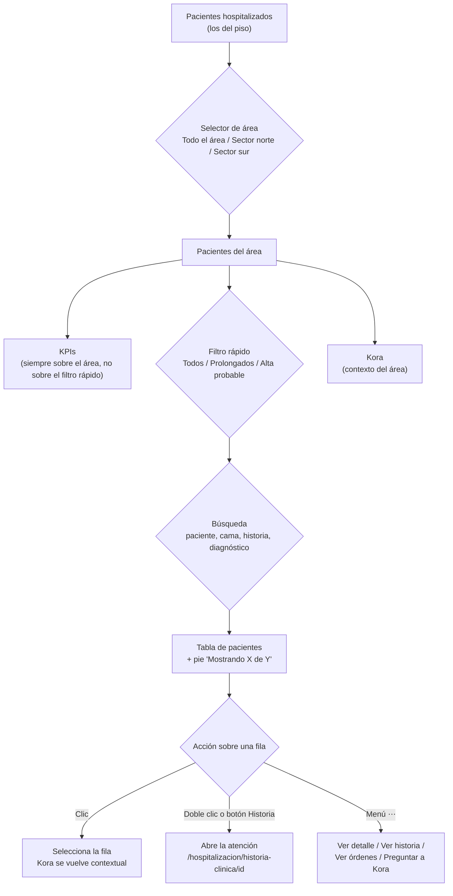

# Documentación funcional — Clintos

## Historia clínica - Hospitalización

**Propósito:** darle al **médico tratante** un tablero con sus pacientes hospitalizados para ver, de un vistazo, a quién le falta la evolución del día, quién tiene resultados nuevos o críticos y quién podría salir de alta, y desde ahí abrir la historia clínica de cada paciente. Es el equivalente médico del Panel general de Enfermería (que mira medicación y dosis): mismas camas y pacientes, distinto foco clínico.

**Rutas:**
- `/hospitalizacion/historia-clinica` (menú Hospitalización → Historia Clínica): tablero "Mis pacientes hospitalizados". Es el alcance principal de este documento.
- `/hospitalizacion/historia-clinica/[id]` (con `?tab=<pestaña>` para abrir directo en una pestaña): atención del paciente hospitalizado. Es la misma pantalla de atención de Consulta externa y de Cirugía, con su variante de Hospitalización. Aquí solo se documenta cómo se llega a ella y qué trae de propio la variante (resumen en la sección "Abrir la atención del paciente"); el detalle del formulario del informe quirúrgico y de las órdenes está en el documento de [Historia clínica de Cirugía](../modulo-cirugias/historia-clinica-cirugia.md).

**Roles** (el rol principal lo indicó el usuario; el resto de roles no se preguntó y se deja sin asumir; hoy el sistema no aplica permisos por rol: la sesión es un usuario de ejemplo, "Administrador"):

| Grupo de acciones | Rol |
|---|---|
| Ver el tablero, filtrar, abrir la historia clínica y las órdenes médicas, ver el detalle de la admisión, preguntar a Kora | **Médico** (rol principal) |
| Registrar evolución, ingreso a hospitalización y demás plantillas en la atención | Médico |

> Pendiente de confirmar: si otros roles (médico interconsultante, jefe de piso, enfermería) pueden entrar a este tablero y con qué permisos.

**Datos que muestra cada paciente:** cama, nombre completo, documento (CC), edad, diagnóstico, estado de la evolución, fecha de ingreso con la estancia. Son los mismos pacientes, camas y diagnósticos que ve Enfermería en su Panel general.

**Estados y marcas:**

| Marca | Dónde | Cuándo aplica |
|---|---|---|
| Evolución **Pendiente** (etiqueta ámbar con punto) | Columna Evolución | El paciente tiene una evolución del día sin registrar. |
| Evolución **Al día** (etiqueta verde con punto) | Columna Evolución | No tiene evolución pendiente. |
| **Nuevo ingreso** (etiqueta azul) | Fecha de ingreso | Ingresó hace menos de 24 horas. No se muestra la hora: la etiqueta ya dice que entró hoy. |
| **N días** con reloj de arena (etiqueta ámbar) | Fecha de ingreso | Estancia prolongada (marca curada por paciente, no calculada). |
| Estancia en texto ("8 días") | Fecha de ingreso | Cualquier otro caso. |
| **Alta probable** | Filtro y KPI | El médico marcó al paciente para egreso hoy o mañana. |

---

### Qué ve el médico y cómo se relacionan los datos

Todo lo que muestra el tablero (KPIs, tabla, contadores de filtro, pie y contexto de Kora) sale de la **misma lista de pacientes ya recortada por el selector de área**. Nunca hay un número que no cuadre con las filas visibles.



---

### Ver los indicadores del tablero

- **Qué hace:** muestra 4 tarjetas con lo que el médico debe atender hoy, calculadas sobre los pacientes del área elegida.
  - **Mis pacientes** (neutro): total de pacientes; descripción "En piso".
  - **Evolución pendiente** (ámbar): pacientes sin nota del día; descripción "Sin nota del día".
  - **Resultados nuevos** (azul): resultados sin revisar; la descripción dice "N críticos" (y la tarjeta pasa a rojo) o "Sin críticos".
  - **Altas probables** (verde): pacientes marcados para egreso hoy o mañana; descripción "Egreso hoy o mañana".
- **Roles con acceso:** Médico.
- **Reglas de negocio:**
  - Son solo informativas (no filtran la tabla al hacer clic).
  - Cambian con el selector de área, no con el filtro rápido ni con la búsqueda.
  - Dos densidades: expandida (con descripción) y compacta (una sola línea: ícono y etiqueta a la izquierda, valor a la derecha). Ver "Expandir o contraer la tabla".
  - Con menos de 1281 px de ancho pasan de 4 columnas a 2.
  - "Órdenes por firmar" se quitó como KPI por decisión explícita; las órdenes siguen disponibles por paciente (menú "⋯" → "Ver órdenes médicas").

### Buscar y filtrar la lista de pacientes

- **Qué hace:** acota la lista con tres controles en una sola fila de herramientas.
  - **Búsqueda** ("Buscar paciente, cama, diagnóstico..."): coincide con nombre, cama, número de historia (HC-xxxxx) y diagnóstico; ignora mayúsculas; tiene botón para limpiar.
  - **Filtro rápido** (selector segmentado con contador): **Todos**, **Prolongados**, **Alta probable**.
  - **Selector de área:** **Todo el área** (por defecto), **Sector norte** (habitaciones 101 a 104) y **Sector sur** (105 a 107). El sector se deduce del número de la cama.
- **Roles con acceso:** Médico.
- **Reglas de negocio:**
  - Los tres se combinan (área, luego filtro rápido, luego búsqueda).
  - El contador de cada chip del filtro rápido se calcula sobre el área elegida, antes de la búsqueda.
  - Si el filtro deja la lista vacía: "No hay pacientes para mostrar. Prueba con otro filtro, otra área o una búsqueda distinta."
  - Si el paciente seleccionado queda fuera del área elegida, la selección (y el contexto de Kora) se descarta sola.
  - El filtro **"Con pendientes"** existe en el código pero está **oculto** (la columna Pendientes también) hasta definir de qué son esos pendientes.

### Ver la tabla de pacientes

- **Qué hace:** una fila por paciente con: **Cama**, **Paciente** (nombre en mayúsculas y debajo "CC documento · edad"), **Diagnóstico**, **Evolución** (Pendiente / Al día), **Fecha de ingreso** (con "Nuevo ingreso", estancia prolongada o "- N días") y **Acciones** (botón "Historia" y menú "⋯").
- **Roles con acceso:** Médico.
- **Reglas de negocio:**
  - Fecha en formato `DD.MES.AAAA` (20.OCT.2026).
  - Encabezado fijo; la tabla scrollea por dentro de su tarjeta.
  - **Clic** en la fila la selecciona (resalta); clic de nuevo sobre la seleccionada la deselecciona. **Doble clic** abre la historia. Con teclado: Enter o espacio selecciona; Enter sobre la fila ya seleccionada la abre.
  - Los clics dentro de la columna Acciones no seleccionan ni abren la fila.
  - Por debajo de 769 px la tabla se reemplaza por **tarjetas** (una por paciente) con los mismos datos y acciones.
  - Sin paginación: se ven todos los pacientes del área.

### Seleccionar un paciente (contexto de Kora)

- **Qué hace:** al seleccionar una fila, el asistente Kora deja de hablar del área en general y pasa a hablar de ese paciente (se muestra un chip de contexto que se puede quitar).
- **Roles con acceso:** Médico.
- **Reglas de negocio:**
  - Quitar el chip, deseleccionar la fila o cambiar a un área que no contiene al paciente devuelve a Kora al contexto de pantalla.
  - Kora puede abrir la historia del paciente que se le sugiere y navegar a otras pantallas.

### Abrir la atención del paciente (botón "Historia", doble clic, "Ver historia clínica", "Ver órdenes médicas")

- **Qué hace:** lleva a `/hospitalizacion/historia-clinica/[id]`. "Ver órdenes médicas" la abre directo en la pestaña de Órdenes médicas (`?tab=ordenes-medicas`); las demás vías, en la pestaña Historia clínica.
- **Roles con acceso:** Médico.
- **Reglas de negocio:**
  - Banner del paciente (variante hospitalización, contraído por defecto): N° de admisión, fecha de ingreso con estancia, cama, médico tratante, diagnóstico; chip de **alergias** si las tiene.
  - Pestañas habilitadas hoy: **Historia clínica** y **Órdenes médicas**. Incapacidades, Consentimiento informado, Resultados, Alergias, Alertas y Archivos aparecen deshabilitadas (no construidas).
  - **Nueva atención** abre el catálogo de plantillas de Hospitalización (52 plantillas, con columna "Sexo" a quién aplica). Hoy solo tienen formulario construido **Ingreso a hospitalización**, **Evaluación preanestésica** e **Informe quirúrgico**. Elegir otra muestra un aviso de que su formulario todavía no está construido. El botón "+" de un grupo de registros abre directo la plantilla que coincide con ese tipo; si no hay una asociada, avisa.
  - Si el paciente no existe o ya no está hospitalizado: "No encontramos este paciente" y botón "Volver a mis pacientes".
  - Los registros de la pestaña Historia clínica son de ejemplo y son los mismos para todos los pacientes hospitalizados.

### Ver el detalle de la admisión (menú "⋯" → "Ver detalle")

- **Qué hace:** abre un modal de solo lectura con la admisión del paciente.
  - Franja de identidad: avatar, nombre, documento, edad detallada ("52 años 3 meses 10 días"), sexo, fecha y hora de ingreso, estancia, cama; N° de admisión e historia en el subtítulo.
  - 4 secciones: **Admisión** (área funcional de ingreso y actual, habitación/cama, médico tratante, diagnóstico de ingreso), **Contratación** (contratante, tipo de contrato, régimen), **Acompañante** (nombre, vínculo, teléfono, dirección) y **Trazabilidad** (médico de ingreso, usuario que ingresa, usuario que da alta).
- **Roles con acceso:** Médico.
- **Reglas de negocio:**
  - Un dato sin valor se muestra como "—", nunca una fila vacía.
  - "Usuario que da alta" queda vacío: el paciente sigue hospitalizado.
  - Botón "Ver historia clínica" abre la atención; Escape o "Cerrar" cierra el modal.
  - Es el mismo modal que usan Admisiones y Enfermería → Pacientes.

### Preguntar a Kora sobre un paciente (menú "⋯")

- **Qué hace:** selecciona la fila y abre el panel de Kora con el contexto de ese paciente.
- **Roles con acceso:** Médico.
- **Reglas de negocio:** también se abre desde el botón "Preguntar a Kora" de la barra superior (con el contexto de lo que haya en pantalla). El panel puede ir a pantalla completa.

### Expandir o contraer la tabla

- **Qué hace:** el botón de solo ícono al extremo derecho de la barra (flechas hacia afuera / hacia adentro) compacta los 4 KPIs a una línea y le cede ese alto a la tabla.
- **Roles con acceso:** Médico.
- **Reglas de negocio:** no se recuerda entre visitas (siempre arranca expandido); tiene estado pulsado accesible.

### Actualizar la lista

- **Qué hace:** el pie de la tarjeta muestra "Mostrando X de Y pacientes · Actualizado a las HH:mm" y el enlace "Actualizar".
- **Roles con acceso:** Médico.
- **Reglas de negocio:** X cambia con filtro y búsqueda; Y es el total del área. Hoy "Actualizar" solo renueva la hora (los datos son fijos); con backend volvería a pedir la lista.

---

## Notas generales y límites conocidos

- **Datos de ejemplo:** los pacientes son los del piso de Enfermería (mismas camas, diagnósticos y estancias). Los pendientes clínicos (evolución, órdenes, resultados, resultados críticos) y las altas probables son valores fijos de ejemplo; con backend deben salir del registro de evoluciones, de las órdenes y del laboratorio.
- **Ocultos por decisión:** el panel lateral "Pendientes clínicos" (top 5 por prioridad: crítico > evolución > orden > resultado normal), la columna "Pendientes" y el filtro "Con pendientes". El código sigue y se reactiva con una constante; hoy "Resultados nuevos" y "Evolución pendiente" son la única señal de pendientes.
- **Sin ordenación manual:** las filas salen en el orden de las camas; las columnas no se ordenan por clic.
- **Sin selección múltiple ni acciones masivas.**
- **Documento ficticio:** el CC que se muestra se deriva del número de historia; no es un documento real.
- **Sede:** el tablero no lleva selector de sede propio; usa la de la barra superior.
- **Fuera de alcance:** formularios de plantillas (Ingreso, Evaluación preanestésica, Informe quirúrgico) y pestaña de Órdenes médicas, que son de la pantalla de atención.

---

## Prompt para crear el front de esta pantalla

Brief para un diseñador o desarrollador que deba construir (o reconstruir) el tablero desde cero. Es autocontenido: no depende del código existente.

```text
Necesito diseñar y construir el tablero "Historia Clínica - Hospitalización" de un sistema clínico hospitalario (producto Clintos). Es la pantalla con la que un médico revisa sus pacientes hospitalizados y entra a la historia clínica de cada uno. Todo el texto de la interfaz va en español.

OBJETIVO
Que el médico, en una mirada, sepa a cuántos pacientes tiene a cargo, a quiénes les falta la nota de evolución del día, cuántos resultados nuevos (y cuántos críticos) tiene sin revisar y quiénes podrían salir de alta hoy o mañana; y que llegue a la historia de cualquier paciente en un clic.

USUARIO
Médico tratante. Un solo rol en esta pantalla; no hay acciones que cambien datos (es un tablero de consulta y entrada).

ESTADOS (siempre con texto, nunca solo color)
- Evolución "Pendiente": etiqueta ámbar con punto de color.
- Evolución "Al día": etiqueta verde con punto de color.
- "Nuevo ingreso": etiqueta azul junto a la fecha (menos de 24 h; sin hora).
- Estancia prolongada: etiqueta ámbar con ícono de reloj de arena y los días ("22 días").

PANTALLA (escritorio, 1025 px o más)
Dentro del marco de la aplicación (barra lateral azul colapsada, y barra superior con migas "Hospitalización > Historia Clínica", selector de sede y de área, botón "Preguntar a Kora" y menú de usuario):
1) Encabezado: título "Historia Clínica - Hospitalización" (24 px, seminegrita) y debajo "Mis pacientes hospitalizados". Sin botones de acción.
2) Fila de 4 indicadores en cuadrícula de 4 columnas con 16 px de separación (tarjetas con ícono en cuadro de color suave, etiqueta en mayúsculas pequeñas, valor grande en negrita y descripción gris): "Mis pacientes" (neutro, "En piso"), "Evolución pendiente" (ámbar, "Sin nota del día"), "Resultados nuevos" (azul; descripción "N críticos" y tarjeta roja si hay críticos, "Sin críticos" si no) y "Altas probables" (verde, "Egreso hoy o mañana"). Solo informativos. Dos densidades: expandida y compacta (una sola línea: ícono y etiqueta a la izquierda, valor a la derecha, sin descripción).
3) Tarjeta principal blanca (borde fino, esquinas de 12 px) que ocupa todo el alto restante y scrollea por dentro:
   a) Barra de herramientas en UNA sola fila, de izquierda a derecha: buscador con lupa y placeholder "Buscar paciente, cama, diagnóstico..." (con botón para limpiar); espacio flexible; selector segmentado "Todos (15) | Prolongados (3) | Alta probable (3)" con contador entre paréntesis en cada opción; selector desplegable de área con ícono de ubicación ("Todo el área", "Sector norte", "Sector sur"); botón cuadrado de solo ícono "Expandir tabla / Contraer tabla" (flechas hacia afuera / hacia adentro; con estado pulsado) que compacta los indicadores. Todos los controles miden 36 px de alto.
   b) Tabla con columnas: Cama · Paciente (nombre en mayúsculas y seminegrita; debajo, en gris pequeño, "CC 1048291 · 67 años") · Diagnóstico · Evolución (etiqueta Pendiente / Al día) · Fecha de ingreso ("20.OCT.2026 - 8 días"; con etiqueta "Nuevo ingreso" o con la etiqueta de estancia prolongada cuando aplique) · Acciones (botón secundario pequeño con ícono de documento y texto "Historia", y un menú "⋯"). Encabezado fijo al hacer scroll, texto de 12 px en seminegrita, sin mayúsculas, fondo gris muy claro. Fila clicable y enfocable: clic la selecciona (fondo azul suave y una barra azul de 3 px a la izquierda), clic de nuevo la deselecciona, doble clic abre la historia; Enter/espacio selecciona y Enter sobre la seleccionada la abre. Los clics en la columna Acciones no activan la fila. Sin paginación.
   c) Menú "⋯" (se abre sobre la fila, hacia arriba si no hay espacio): "Ver detalle" (ícono de tarjeta de identidad), "Ver historia clínica" (documento), "Ver órdenes médicas" (portapapeles; abre la historia directo en esa pestaña), y, tras una línea separadora, "Preguntar a Kora sobre este paciente" (destellos).
   d) Pie de la tarjeta: "Mostrando 15 de 15 pacientes · Actualizado a las 04:26 p. m." y enlace con ícono "Actualizar". El pie reserva espacio para que el botón flotante de Kora no tape la última fila.
4) Panel de Kora (asistente): botón flotante azul "Kora" abajo a la derecha; abierto, ocupa una columna lateral a la altura del contenido (debajo de la barra superior). Al seleccionar un paciente muestra un chip de contexto con el paciente y botón para quitarlo.
5) Modal "Detalle de admisión" (ancho medio, cabecera con título, subtítulo "Admisión N.º · Historia HC-xxxxx" y botón cerrar; pie con "Cerrar" y "Ver historia clínica"): franja con avatar de iniciales, nombre, documento, edad detallada y sexo, más ingreso, estancia y cama; y cuatro secciones de pares etiqueta/valor — Admisión, Contratación, Acompañante, Trazabilidad. Dato sin valor = "—".

TABLET (768 a 1024 px)
Barra lateral colapsada. Los KPIs pasan a 2 columnas por debajo de 1281 px. La tabla se mantiene.

MÓVIL (menos de 769 px)
La tabla se reemplaza por tarjetas apiladas (una por paciente): arriba nombre y "Cama 101-A · CC …" con la etiqueta de evolución a la derecha; debajo diagnóstico y edad, e ingreso; abajo, alineados a la derecha, el botón "Historia" y el menú "⋯". Misma selección y doble toque abre.

ESTADOS DE LA INTERFAZ
- Vacío (filtro o búsqueda sin resultados): mensaje centrado "No hay pacientes para mostrar" y debajo "Prueba con otro filtro, otra área o una búsqueda distinta."
- Si el paciente seleccionado queda fuera del área elegida, se deselecciona solo.
- Los indicadores cambian con el área, no con el filtro rápido ni con la búsqueda; el contador de cada opción del filtro rápido también se calcula solo con el área.

ESTILO
Sistema de diseño sobrio y clínico. Azul primario para acciones y selección; ámbar, verde, azul y rojo solo como estados, siempre acompañados de texto. Tipografía del sistema (system-ui). Escala: 11, 12, 14, 16, 18, 20, 24 y 28 px; títulos en seminegrita (600), cifras de los indicadores en negrita (700). Fechas con formato DD.MES.AAAA (20.OCT.2026). Íconos de línea (estilo Lucide). Foco visible de 2 px en todos los controles; respeta el tema claro y oscuro.

ACCESIBILIDAD
Tabla con encabezados reales y fila seleccionada anunciada (aria-selected). Columna de acciones con encabezado oculto "Acciones". Contador del pie con anuncio educado (aria-live). Menú "⋯" con etiqueta "Más acciones para <paciente>", navegable con flechas, Inicio/Fin y Escape (devuelve el foco al botón). Botón expandir con aria-pressed y etiqueta cambiante.

DATOS DE EJEMPLO PARA EL PROTOTIPO
15 pacientes en camas 101-A a 107-B. Ejemplo: 101-A María Fernanda González Restrepo, CC 1048291, 67 años, "Neumonía adquirida en comunidad", evolución Pendiente, ingreso 20.OCT.2026 - 8 días. 102-B Jorge Iván Ramírez Ospina, 48 años, "Colecistitis aguda", Al día, 28.OCT.2026 con "Nuevo ingreso". 103-A Patricia Elena López Cardona, 71 años, "EPOC exacerbado", Pendiente, 06.OCT.2026 con estancia prolongada "22 días". KPIs de ejemplo: 15 pacientes, 5 evoluciones pendientes, 5 resultados nuevos (2 críticos), 3 altas probables.

FUERA DE ALCANCE
La pantalla de atención del paciente (banner, pestañas Historia clínica y Órdenes médicas, formularios de plantillas): solo hay que enlazarla desde el botón "Historia" y las opciones del menú.
```
